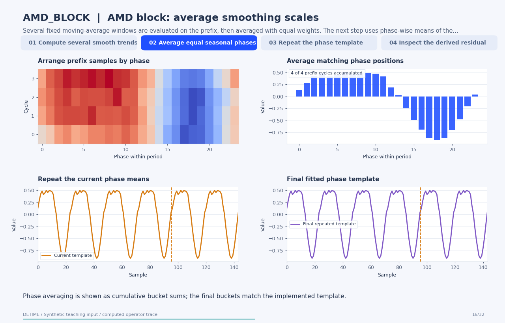

# AMD block: average smoothing scales

[← All 31 animations](index.md)

<!-- detime:method-animation:start -->
## How it works

**Method maturity:** `experimental`. **Implementation:** `python`.

Several fixed moving-average windows are evaluated on the prefix, then averaged with equal weights. The next step uses phase-wise means of the detrended prefix. The frames expose those buckets, their cumulative averages and the repeated seasonal output. The source architecture's adaptive weighting is represented here by a nonlearned, equal-weight average of fixed smoothers.

[](../assets/generated/method-animations/amd-block.gif)

Deterministic synthetic teaching signal; not a benchmark.

[Open GIF](../assets/generated/method-animations/amd-block.gif) · [Static PNG](../assets/generated/method-animations/amd-block.png) · [Source arrays (NPZ)](../assets/generated/method-animations/amd-block.npz) · [Trace metadata](../assets/generated/method-animations/amd-block.json)

### Follow the four steps

**1. Compute several smooth trends**

Several fixed moving-average windows are evaluated on the prefix, then averaged with equal weights.

**2. Average equal seasonal phases**

Subtract the trend on the fitting prefix. Group samples by index modulo the specified period and average each phase bucket.

**3. Repeat the phase template**

Tile the fitted phase means over the record. The suffix does not update the template in this prefix configuration.

**4. Inspect the derived residual**

Compute input minus the implemented trend and seasonal estimate. This residual is part of a retrospective decomposition, not a forecast score.

### Parameters that change the result

| Parameter | Effect on the computation |
|---|---|
| `multiscale_windows` | Sets the windows whose trends are equally averaged; this standalone operator does not learn scale weights. |
| `primary_period` | Defines phase buckets in samples; the fitting prefix must contain enough cycles for an interpretable average. |
| `fit_scope / train_fraction` | Explicitly selects a two-thirds prefix in this example; it does not create a rolling forecasting evaluation. |

### What this animation computes

Intermediate arrays are computed with the implemented operator helpers. The final trend, season and residual are checked against public decompose(). The animation explains this standalone experimental block; its source architecture is cited for provenance.

### Interpretation

- The source architecture's adaptive weighting is represented here by a nonlearned, equal-weight average of fixed smoothers.
- Prefix fitting is a fixed fitting convention. It does not certify rolling causality or an out-of-sample prediction experiment.
- A repeated phase template assumes that the fitted seasonal shape remains useful over the displayed suffix.
- The residual is derived by subtraction; exact reconstruction does not validate the scientific interpretation of either component.

### Try the method

Use this configuration with DecompositionConfig and decompose. The animation generator supplies the teaching input and records intermediate arrays.

```json
{
  "method": "AMD_BLOCK",
  "params": {
    "primary_period": 24,
    "fit_scope": "prefix",
    "train_fraction": 0.6666666666666666,
    "multiscale_windows": [
      13,
      25,
      49
    ]
  },
  "backend": "python"
}
```

See [the configuration reference](../config-reference.md#amd_block) for the full interface and optional dependencies.

### Sources and reproduction

- [Implemented DeTime operator](https://github.com/systems-mechanobiology/DeTime/blob/main/src/detime/methods/neural_blocks/neural_block_portfolio.py)
- [Hu et al. (2024), Adaptive Multi-Scale Decomposition Framework for Time Series Forecasting](https://arxiv.org/abs/2406.03751)
- [DeTime implementation: `src/detime/methods/neural_blocks/neural_block_portfolio.py`](https://github.com/systems-mechanobiology/DeTime/blob/main/src/detime/methods/neural_blocks/neural_block_portfolio.py)

Regenerate this animation with `python scripts/generate_method_animations.py --methods AMD_BLOCK`.
The [reproduction guide](../maintenance/method-animations.md) explains the environment,
numerical checks, coverage manifest, and how to inspect the stored arrays.
<!-- detime:method-animation:end -->
