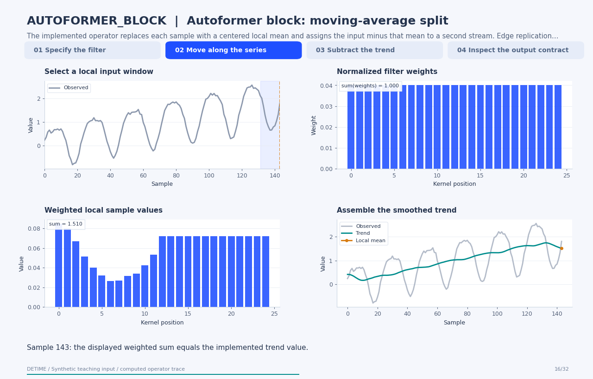

# Autoformer block: moving-average split

[← All 31 animations](index.md)

<!-- detime:method-animation:start -->
## How it works

**Method maturity:** `experimental`. **Implementation:** `python`. **Numerical alias of:** `MOVING_AVERAGE_DECOMPOSITION_BLOCK`.

The implemented operator replaces each sample with a centered local mean and assigns the input minus that mean to a second stream. Edge replication maintains the original length. AUTOFORMER_BLOCK, DLINEAR_BLOCK and MOVING_AVERAGE_DECOMPOSITION_BLOCK call the same numeric implementation at equal settings; their method identifiers record provenance. The animation therefore shows the same numerical mechanism for all three, with a separate named asset for each entry.

[](../assets/generated/method-animations/autoformer-block.gif)

Deterministic synthetic teaching signal; not a benchmark.

[Open GIF](../assets/generated/method-animations/autoformer-block.gif) · [Static PNG](../assets/generated/method-animations/autoformer-block.png) · [Source arrays (NPZ)](../assets/generated/method-animations/autoformer-block.npz) · [Trace metadata](../assets/generated/method-animations/autoformer-block.json)

### Follow the four steps

**1. Specify the filter**

Inspect the normalized filter weights and the replicated-edge input window used for a local mean.

**2. Move along the series**

At each sample, multiply the local values by the same fixed kernel and sum them to form the trend.

**3. Subtract the trend**

Compute the nontrend stream as the input minus the smoothed trend, sample by sample.

**4. Inspect the output contract**

The two streams already reconstruct the input, leaving a derived residual of zero up to arithmetic precision.

### Parameters that change the result

| Parameter | Effect on the computation |
|---|---|
| `moving_avg` | Sets the smoothing window. Larger windows average more samples; even requests become odd windows. |
| `window` | Acts as an alias after moving_avg. If neither is supplied, period hints are checked before the default window of 25. |
| `primary_period` | Can supply a window hint; this operator does not fit a periodic template. |

### What this animation computes

Intermediate arrays are computed with the implemented operator helpers. The final trend, season and residual are checked against public decompose(). The animation explains this standalone experimental block; its source architecture is cited for provenance.

### Interpretation

- The three registered moving-average block names are numerical aliases at equal configuration.
- This is the decomposition head. It does not execute Autoformer attention or DLinear's fitted forecasting projections.
- The nontrend stream can contain noise and transients. Here season = input - trend, so the derived residual is zero by construction.
- The centered filter uses future neighbours relative to an interior sample in a full-record analysis.

### Try the method

Use this configuration with DecompositionConfig and decompose. The animation generator supplies the teaching input and records intermediate arrays.

```json
{
  "method": "AUTOFORMER_BLOCK",
  "params": {
    "moving_avg": 25
  },
  "backend": "python"
}
```

See [the configuration reference](../config-reference.md#autoformer_block) for the full interface and optional dependencies.

### Sources and reproduction

- [Implemented DeTime operator](https://github.com/systems-mechanobiology/DeTime/blob/main/src/detime/methods/neural_blocks/forecasting_blocks.py)
- [Wu et al. (2021), Autoformer: Decomposition Transformers with Auto-Correlation for Long-Term Series Forecasting](https://proceedings.neurips.cc/paper_files/paper/2021/hash/bcc0d400288793e8bdcd7c19a8ac0c2b-Abstract.html)
- [DeTime implementation: `src/detime/methods/neural_blocks/forecasting_blocks.py`](https://github.com/systems-mechanobiology/DeTime/blob/main/src/detime/methods/neural_blocks/forecasting_blocks.py)

Regenerate this animation with `python scripts/generate_method_animations.py --methods AUTOFORMER_BLOCK`.
The [reproduction guide](../maintenance/method-animations.md) explains the environment,
numerical checks, coverage manifest, and how to inspect the stored arrays.
<!-- detime:method-animation:end -->
