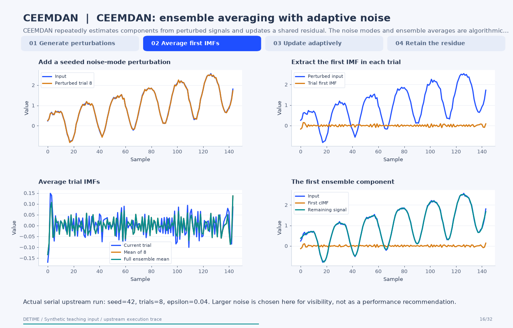
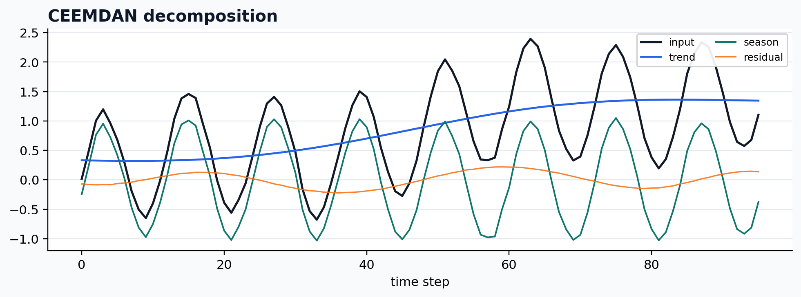

<a class="method-detail-back" href="../../notebook-gallery/">← Back to Gallery</a>

<div class="method-detail-header">
  <h1>Noise-assisted EMD</h1>
  <p>Noise-assisted EMD</p>
  <svg viewBox="0 0 400 100" xmlns="http://www.w3.org/2000/svg"><g fill="none" stroke-linecap="round"><path d="M0 50 C30 20 60 78 90 42 S150 16 180 52 S240 80 300 34 S360 14 400 50" stroke="#1F4FFF" stroke-width="2.6" stroke-opacity=".28"/><path d="M0 62 C80 58 160 48 240 38 S340 26 400 24" stroke="#00A6A6" stroke-width="2.2" stroke-opacity=".18"/><path d="M0 74 C20 66 40 82 60 72 S100 64 120 74 S160 82 180 72 S220 64 240 74 S300 82 400 68" stroke="#9AA8C7" stroke-width="1.8" stroke-opacity=".14"/></g></svg>
</div>

| Property | Value |
|---|---|
| **Method** | `CEEMDAN` |
| **Input mode** | `univariate` |
| **Trend shape** | `(96,)` |
| **Status** | ran |
| **Residual RMSE** | 0.00000000 |

<!-- detime:method-animation:start -->
## How it works

CEEMDAN repeatedly estimates components from perturbed signals and updates a shared residual. The noise modes and ensemble averages are algorithmic inputs, not decorative uncertainty bands.

[](../assets/generated/method-animations/ceemdan.gif)

Deterministic synthetic teaching signal; not a benchmark.

[Open GIF](../assets/generated/method-animations/ceemdan.gif) · [Static PNG](../assets/generated/method-animations/ceemdan.png) · [Source arrays (NPZ)](../assets/generated/method-animations/ceemdan.npz) · [Trace metadata](../assets/generated/method-animations/ceemdan.json)

### Follow the four steps

**1. Generate perturbations**

Normalize the input, draw seeded noise, and decompose the noise realizations.

**2. Average first IMFs**

Apply EMD to each perturbed input and average its first IMF.

**3. Update adaptively**

Perturb the current residual with the next noise mode, average local means, and extract the next cIMF.

**4. Retain the residue**

Continue until the stopping criterion, then retain the remaining signal for additive reconstruction.

### Parameters that change the result

| Parameter | Effect on the computation |
|---|---|
| `trials` | Number of ensemble members; this small animation uses 8, while DeTime's default is 100. |
| `epsilon` | Controls the perturbation scale; this visibility-oriented trace uses 0.04, not the default 0.005. |
| `seed and n_jobs` | The trace uses seed 42 and serial execution. Preserve both for reproducibility. |
| `primary_period` | Affects DeTime's grouping after the upstream component extraction. |

### What this animation computes

Trial inputs, first IMFs, and adaptive local means recorded from EMD-signal 1.10.0; max_imf=3 bounds this upstream teaching run. DeTime's example below exposes the public controls and does not set this internal trace cap.

### Interpretation

- Different CEEMDAN variants exist; PyEMD includes the later improved formulation documented by its authors.
- An ensemble average does not establish that an IMF is a unique physical component.
- Raw DeTime IMF arrays use (mode, time, channel), including a singleton channel for one series.

### Try the method

Use this configuration with DecompositionConfig and decompose. The animation generator supplies the teaching input and records intermediate arrays.

```json
{
  "method": "CEEMDAN",
  "params": {
    "trials": 8,
    "epsilon": 0.04,
    "primary_period": 24
  },
  "seed": 42,
  "n_jobs": 1,
  "backend": "python"
}
```

See [the configuration reference](../config-reference.md#ceemdan) for the full interface and optional dependencies.

### Sources and reproduction

- [PyEMD CEEMDAN implementation and reproducibility](https://pyemd.readthedocs.io/en/latest/ceemdan.html)
- [Torres et al. (2011)](https://doi.org/10.1109/ICASSP.2011.5947265)
- [Colominas et al. (2014)](https://doi.org/10.1016/j.bspc.2014.06.009)
- [DeTime implementation: `src/detime/methods/ceemdan.py`](https://github.com/systems-mechanobiology/DeTime/blob/main/src/detime/methods/ceemdan.py)

Regenerate this animation with `python scripts/generate_method_animations.py --methods CEEMDAN`.
The [reproduction guide](../maintenance/method-animations.md) explains the environment,
numerical checks, coverage manifest, and how to inspect the stored arrays.
<!-- detime:method-animation:end -->

## Code

```python
case = CASES["CEEMDAN"]
run_gallery_case("CEEMDAN")
```

## Output

<div class="gallery-out">
<pre>
CEEMDAN: Noise-assisted EMD
status: ran
...
</pre>
</div>

## Decomposition Plot


