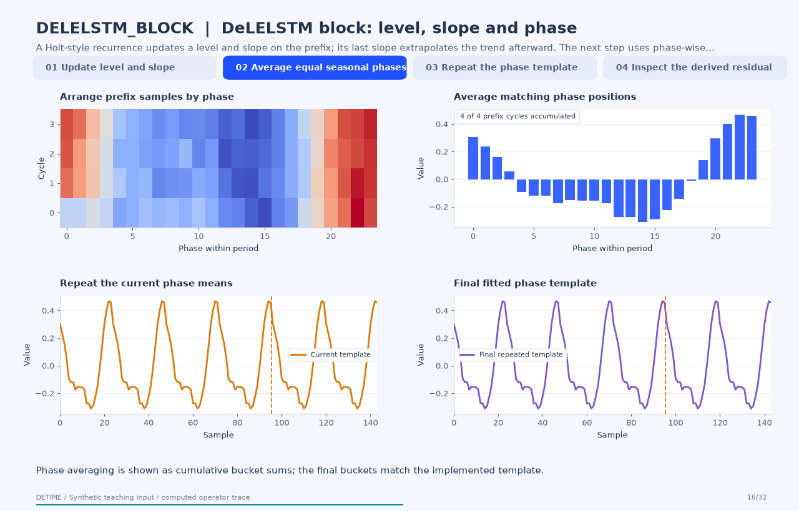

# DeLELSTM block: level, slope and phase

[Back to methods](../methods.md#animated-method-explanations)

**Method:** `DELELSTM_BLOCK`. **Status:** experimental. **Implementation:** python.

<!-- detime:method-animation:start -->
## How it works

A Holt-style recurrence updates a level and slope on the prefix; its last slope extrapolates the trend afterward. The next step uses phase-wise means of the detrended prefix. The frames expose those buckets, their cumulative averages and the repeated seasonal output. The implemented trend is a level/slope recurrence with a phase template. No LSTM cell is trained or evaluated.

[](../assets/generated/method-animations/delelstm-block.gif)

Deterministic synthetic teaching signal; not a benchmark.

[Open GIF](../assets/generated/method-animations/delelstm-block.gif) · [Static PNG](../assets/generated/method-animations/delelstm-block.png) · [Source arrays (NPZ)](../assets/generated/method-animations/delelstm-block.npz) · [Trace metadata](../assets/generated/method-animations/delelstm-block.json)

### Follow the four steps

**1. Update level and slope**

A Holt-style recurrence updates a level and slope on the prefix; its last slope extrapolates the trend afterward.

**2. Average equal seasonal phases**

Subtract the trend on the fitting prefix. Group samples by index modulo the specified period and average each phase bucket.

**3. Repeat the phase template**

Tile the fitted phase means over the record. The suffix does not update the template in this prefix configuration.

**4. Inspect the derived residual**

Compute input minus the implemented trend and seasonal estimate. This residual is part of a retrospective decomposition, not a forecast score.

### Parameters that change the result

| Parameter | Effect on the computation |
|---|---|
| `alpha / beta` | Control level and slope updates in the implemented Holt recurrence; no LSTM cell is evaluated. |
| `primary_period` | Defines phase buckets in samples; the fitting prefix must contain enough cycles for an interpretable average. |
| `fit_scope / train_fraction` | Explicitly selects a two-thirds prefix in this example; it does not create a rolling forecasting evaluation. |

### What this animation computes

Intermediate arrays are computed with the implemented operator helpers. The final trend, season and residual are checked against public decompose(). The animation explains this standalone experimental block; its source architecture is cited for provenance.

### Interpretation

- The implemented trend is a level/slope recurrence with a phase template. No LSTM cell is trained or evaluated.
- Prefix fitting is a fixed fitting convention. It does not certify rolling causality or an out-of-sample prediction experiment.
- A repeated phase template assumes that the fitted seasonal shape remains useful over the displayed suffix.
- The residual is derived by subtraction; exact reconstruction does not validate the scientific interpretation of either component.

### Try the method

Use this configuration with DecompositionConfig and decompose. The animation generator supplies the teaching input and records intermediate arrays.

```json
{
  "method": "DELELSTM_BLOCK",
  "params": {
    "primary_period": 24,
    "fit_scope": "prefix",
    "train_fraction": 0.6666666666666666,
    "alpha": 0.4,
    "beta": 0.2
  },
  "backend": "python"
}
```

See [the configuration reference](../config-reference.md#delelstm_block) for the full interface and optional dependencies.

### Sources and reproduction

- [Implemented DeTime operator](https://github.com/systems-mechanobiology/DeTime/blob/main/src/detime/methods/neural_blocks/neural_block_portfolio.py)
- [Wang et al. (2023), DeLELSTM: Decomposition-based Linear Explainable LSTM to Capture Instantaneous and Long-term Effects in Time Series](https://arxiv.org/abs/2308.13797)
- [DeTime implementation: `src/detime/methods/neural_blocks/neural_block_portfolio.py`](https://github.com/systems-mechanobiology/DeTime/blob/main/src/detime/methods/neural_blocks/neural_block_portfolio.py)

Regenerate this animation with `python scripts/generate_method_animations.py --methods DELELSTM_BLOCK`.
The [reproduction guide](../maintenance/method-animations.md) explains the environment,
numerical checks, coverage manifest, and how to inspect the stored arrays.
<!-- detime:method-animation:end -->
