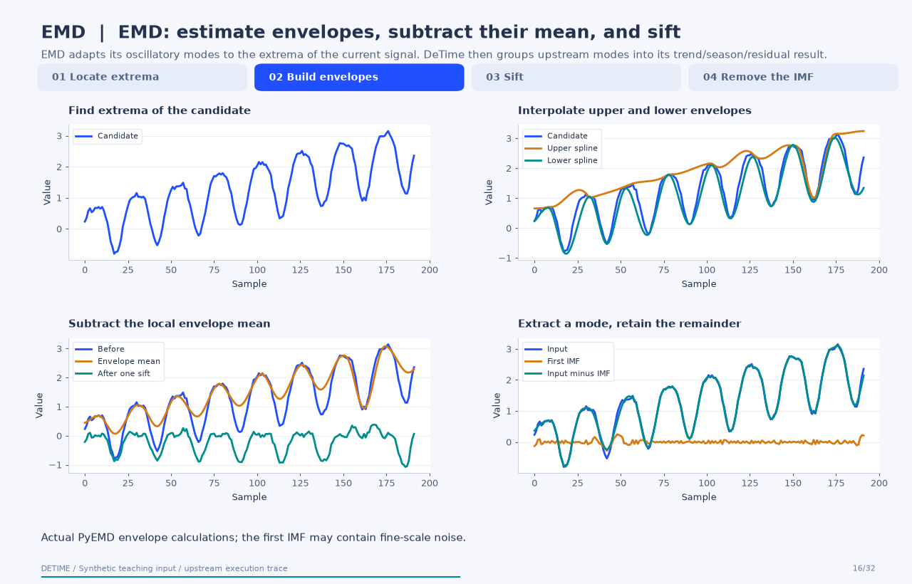
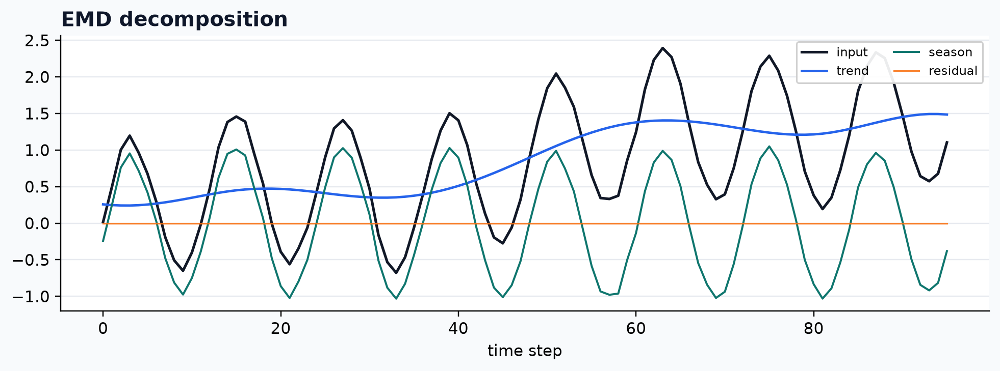

<a class="method-detail-back" href="../../notebook-gallery/">← Back to Gallery</a>

<div class="method-detail-header">
  <h1>Empirical mode decomposition</h1>
  <p>Empirical mode decomposition</p>
  <svg viewBox="0 0 400 100" xmlns="http://www.w3.org/2000/svg"><g fill="none" stroke-linecap="round"><path d="M0 50 C30 20 60 78 90 42 S150 16 180 52 S240 80 300 34 S360 14 400 50" stroke="#1F4FFF" stroke-width="2.6" stroke-opacity=".28"/><path d="M0 62 C80 58 160 48 240 38 S340 26 400 24" stroke="#00A6A6" stroke-width="2.2" stroke-opacity=".18"/><path d="M0 74 C20 66 40 82 60 72 S100 64 120 74 S160 82 180 72 S220 64 240 74 S300 82 400 68" stroke="#9AA8C7" stroke-width="1.8" stroke-opacity=".14"/></g></svg>
</div>

| Property | Value |
|---|---|
| **Method** | `EMD` |
| **Input mode** | `univariate` |
| **Trend shape** | `(96,)` |
| **Status** | ran |
| **Residual RMSE** | 0.00000000 |

<!-- detime:method-animation:start -->
## How it works

EMD adapts its oscillatory modes to the extrema of the current signal. DeTime then groups upstream modes into its trend/season/residual result.

[](../assets/generated/method-animations/emd.gif)

Deterministic synthetic teaching signal; not a benchmark.

[Open GIF](../assets/generated/method-animations/emd.gif) · [Static PNG](../assets/generated/method-animations/emd.png) · [Source arrays (NPZ)](../assets/generated/method-animations/emd.npz) · [Trace metadata](../assets/generated/method-animations/emd.json)

### Follow the four steps

**1. Locate extrema**

Local maxima and minima anchor the envelope construction.

**2. Build envelopes**

PyEMD interpolates upper and lower envelopes with its boundary treatment.

**3. Sift**

Subtract their pointwise mean, recompute extrema, and apply the stopping criteria.

**4. Remove the IMF**

Subtract the accepted mode from the signal and continue on the remainder.

### Parameters that change the result

| Parameter | Effect on the computation |
|---|---|
| `n_imfs` | Limits extracted modes in DeTime's PyEMD call; a final residue can also be returned. |
| `primary_period / explicit IMF groups` | Controls DeTime's subsequent grouping; it does not determine the sifting envelopes. |
| `PyEMD stopping criteria` | This trace uses the upstream defaults; DeTime's wrapper exposes a narrower parameter surface. |

### What this animation computes

Envelope calls recorded from EMD-signal 1.10.0 with default sifting settings and max_imf=1. All curves are computed; no intermediate curve is interpolated between final results.

### Interpretation

- EMD modes are not uniquely identified physical sources; the first mode is not automatically the desired season.
- Spline boundary choices and added observations can change previously estimated components.
- The animation records the first IMF; it does not imply the algorithm stops after one mode.

### Try the method

Use this configuration with DecompositionConfig and decompose. The animation generator supplies the teaching input and records intermediate arrays.

```json
{
  "method": "EMD",
  "params": {
    "n_imfs": 3,
    "primary_period": 24
  }
}
```

See [the configuration reference](../config-reference.md#emd) for the full interface and optional dependencies.

### Sources and reproduction

- [PyEMD EMD algorithm and envelope API](https://pyemd.readthedocs.io/en/latest/emd.html)
- [Huang et al. (1998)](https://doi.org/10.1098/rspa.1998.0193)
- [DeTime implementation: `src/detime/methods/emd.py`](https://github.com/systems-mechanobiology/DeTime/blob/main/src/detime/methods/emd.py)

Regenerate this animation with `python scripts/generate_method_animations.py --methods EMD`.
The [reproduction guide](../maintenance/method-animations.md) explains the environment,
numerical checks, coverage manifest, and how to inspect the stored arrays.
<!-- detime:method-animation:end -->

## Code

```python
case = CASES["EMD"]
run_gallery_case("EMD")
```

## Output

<div class="gallery-out">
<pre>
EMD: Empirical mode decomposition
status: ran
...
</pre>
</div>

## Decomposition Plot


