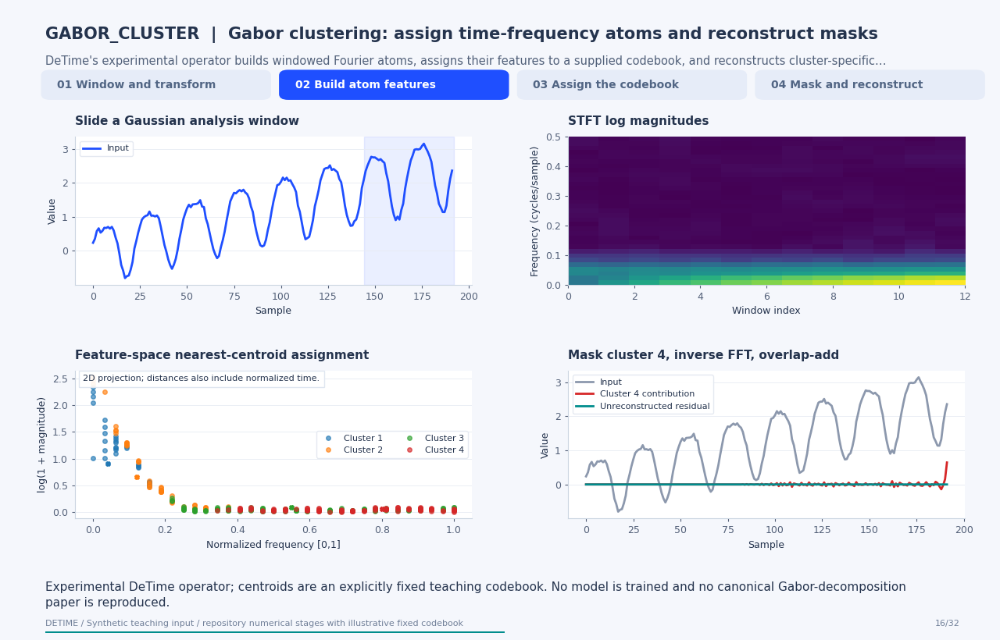

[← All 31 animations](index.md)

<div class="method-detail-header">
  <h1>Experimental Gabor clustering path</h1>
  <p>Experimental Gabor clustering path</p>
  <svg viewBox="0 0 400 100" xmlns="http://www.w3.org/2000/svg"><g fill="none" stroke-linecap="round"><path d="M0 50 C30 20 60 78 90 42 S150 16 180 52 S240 80 300 34 S360 14 400 50" stroke="#1F4FFF" stroke-width="2.6" stroke-opacity=".28"/><path d="M0 62 C80 58 160 48 240 38 S340 26 400 24" stroke="#00A6A6" stroke-width="2.2" stroke-opacity=".18"/><path d="M0 74 C20 66 40 82 60 72 S100 64 120 74 S160 82 180 72 S220 64 240 74 S300 82 400 68" stroke="#9AA8C7" stroke-width="1.8" stroke-opacity=".14"/></g></svg>
</div>

| Property | Value |
|---|---|
| **Method** | `GABOR_CLUSTER` |
| **Input mode** | `univariate` |
| **Trend shape** | `` |
| **Notebook execution** | skipped |
| **Reconstruction RMSE** | n/a |

<!-- detime:notebook-metric:start -->
Notebook example metric: root mean square of `input - (trend + season + residual)` over all samples and channels. This checks additive bookkeeping; it is not a forecast error or a component-recovery score. The separate teaching input and intermediate arrays for the animation are linked below.
<!-- detime:notebook-metric:end -->

<!-- detime:method-animation:start -->
## How it works

**Method maturity:** `experimental`. **Implementation:** `native-backed`.

DeTime's experimental operator builds windowed Fourier atoms, assigns their features to a supplied codebook, and reconstructs cluster-specific contributions with overlap-add.

[](../assets/generated/method-animations/gabor-cluster.gif)

Deterministic synthetic teaching signal; not a benchmark.

[Open GIF](../assets/generated/method-animations/gabor-cluster.gif) · [Static PNG](../assets/generated/method-animations/gabor-cluster.png) · [Source arrays (NPZ)](../assets/generated/method-animations/gabor-cluster.npz) · [Trace metadata](../assets/generated/method-animations/gabor-cluster.json)

### Follow the four steps

**1. Window and transform**

Slide the normalized Gaussian window and compute real FFT coefficients.

**2. Build atom features**

Represent each time-frequency bin by normalized time, normalized frequency, and log amplitude.

**3. Assign the codebook**

Standardize features with the stored mean/scale and select the nearest supplied centroid.

**4. Mask and reconstruct**

Retain each cluster's complex coefficients, apply inverse FFT and normalized overlap-add, then group contributions heuristically.

### Parameters that change the result

| Parameter | Effect on the computation |
|---|---|
| `model / model_path` | A supplied GaborClusterModel is required; the decomposition function does not train a codebook. |
| `win_len / hop / n_fft` | Stored in the model; the example uses 48/12/64 and a Gaussian window. |
| `max_clusters` | Optionally retains the highest-energy clusters before reconstruction. |
| `trend_freq_thr` | Heuristic threshold on the de-standardized centroid frequency, normalized from zero to Nyquist. |

### What this animation computes

Uses the current repository's window, STFT, feature extraction and inverse-overlap-add functions. Squared Euclidean assignment matches the supplied-centroid operation; native cluster reconstructions are independently compared when available. Model normalization, fixed teaching centroids, and numeric window settings are saved with the trace. The public call requires a GaborClusterModel or a model archive created with its save() method; the generic config is incomplete until that model is supplied.

### Interpretation

- This is an experimental, repository-specific operator, not a claimed reproduction of a canonical forecasting or decomposition architecture.
- The fixed four-centroid teaching codebook is neither trained nor evidence of a useful scientific clustering.
- The current frame grid can leave an uncovered tail when the record length is not aligned with the hop; the residual retains that difference.
- Cluster labels are codebook labels; assigning low-frequency clusters to trend is a heuristic.

### Try the method

The public method requires a GaborClusterModel object or a saved model_path. The animation generator constructs an explicitly fixed teaching codebook; the arrays are included in its source archive. Supply a model before calling decompose with the configuration below.

```json
{
  "method": "GABOR_CLUSTER",
  "params": {
    "trend_freq_thr": 0.08
  }
}
```

See [the configuration reference](../config-reference.md#gabor_cluster) for the full interface and optional dependencies.

### Sources and reproduction

- [DeTime Gabor operator source](https://github.com/systems-mechanobiology/DeTime/blob/main/src/detime/methods/gabor_cluster.py)
- [DeTime native Gabor kernels](https://github.com/systems-mechanobiology/DeTime/blob/main/native/src/gabor.cpp)
- [DeTime implementation: `src/detime/methods/gabor_cluster.py`](https://github.com/systems-mechanobiology/DeTime/blob/main/src/detime/methods/gabor_cluster.py)
- [DeTime implementation: `native/src/gabor.cpp`](https://github.com/systems-mechanobiology/DeTime/blob/main/native/src/gabor.cpp)

Regenerate this animation with `python scripts/generate_method_animations.py --methods GABOR_CLUSTER`.
The [reproduction guide](../maintenance/method-animations.md) explains the environment,
numerical checks, coverage manifest, and how to inspect the stored arrays.
<!-- detime:method-animation:end -->

## Code

```python
case = CASES["GABOR_CLUSTER"]
print(case["skip"])
```

## Output

<div class="gallery-out">
<pre>
requires a trained GaborClusterModel or model_path plus the experimental clustering backend
</pre>
</div>
