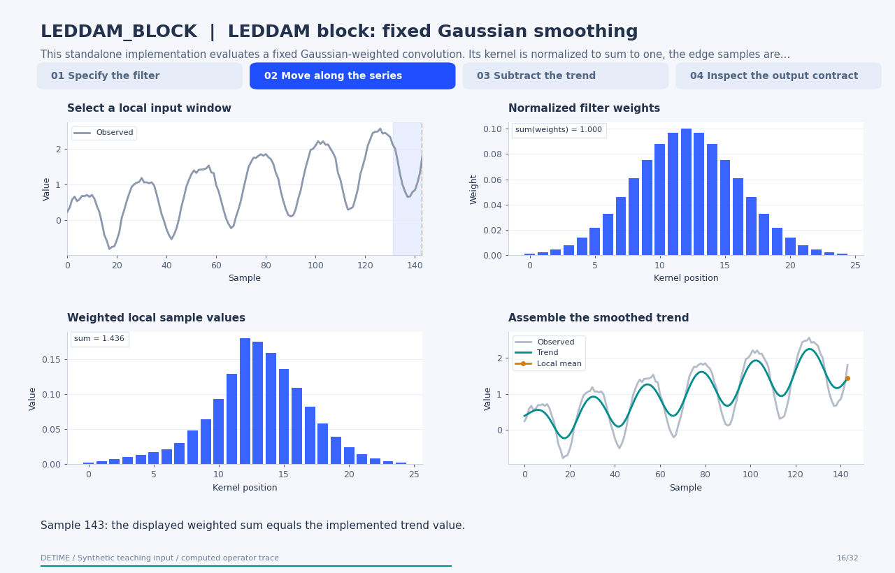

# LEDDAM block: fixed Gaussian smoothing

[← All 31 animations](index.md)

<!-- detime:method-animation:start -->
## How it works

**Method maturity:** `experimental`. **Implementation:** `python`.

This standalone implementation evaluates a fixed Gaussian-weighted convolution. Its kernel is normalized to sum to one, the edge samples are replicated, and the filtered signal becomes the trend stream. Subtracting that stream from the input creates the second stream. The animation displays actual weights and local products before assembling the output. The kernel is not trained in this operator.

[](../assets/generated/method-animations/leddam-block.gif)

Deterministic synthetic teaching signal; not a benchmark.

[Open GIF](../assets/generated/method-animations/leddam-block.gif) · [Static PNG](../assets/generated/method-animations/leddam-block.png) · [Source arrays (NPZ)](../assets/generated/method-animations/leddam-block.npz) · [Trace metadata](../assets/generated/method-animations/leddam-block.json)

### Follow the four steps

**1. Specify the filter**

Inspect the normalized filter weights and the replicated-edge input window used for a local mean.

**2. Move along the series**

At each sample, multiply the local values by the same fixed kernel and sum them to form the trend.

**3. Subtract the trend**

Compute the nontrend stream as the input minus the smoothed trend, sample by sample.

**4. Inspect the output contract**

The two streams already reconstruct the input, leaving a derived residual of zero up to arithmetic precision.

### Parameters that change the result

| Parameter | Effect on the computation |
|---|---|
| `kernel_size` | Sets the odd filter support; even requests are rounded to an odd size and clipped to input length. |
| `sigma` | Controls the Gaussian weight spread in sample units. The example uses 4.0; the implementation default is 1.0. |

### What this animation computes

Intermediate arrays are computed with the implemented operator helpers. The final trend, season and residual are checked against public decompose(). The animation explains this standalone experimental block; its source architecture is cited for provenance.

### Interpretation

- The package computes a fixed Gaussian kernel. Its LEDDAM-inspired name does not imply trained convolution weights or the complete dual-attention architecture.
- Centered windows use samples on both sides of an interior point. Use only the history available at each forecast origin for forecasting features.
- The second stream contains everything removed by smoothing; its name does not establish periodicity. The derived residual is zero by construction.

### Try the method

Use this configuration with DecompositionConfig and decompose. The animation generator supplies the teaching input and records intermediate arrays.

```json
{
  "method": "LEDDAM_BLOCK",
  "params": {
    "kernel_size": 25,
    "sigma": 4.0
  },
  "backend": "python"
}
```

See [the configuration reference](../config-reference.md#leddam_block) for the full interface and optional dependencies.

### Sources and reproduction

- [Implemented DeTime operator](https://github.com/systems-mechanobiology/DeTime/blob/main/src/detime/methods/neural_blocks/leddam_block.py)
- [Yu et al. (2024), Revitalizing Multivariate Time Series Forecasting: Learnable Decomposition with Inter-Series Dependencies and Intra-Series Variations Modeling](https://arxiv.org/abs/2402.12694)
- [DeTime implementation: `src/detime/methods/neural_blocks/leddam_block.py`](https://github.com/systems-mechanobiology/DeTime/blob/main/src/detime/methods/neural_blocks/leddam_block.py)

Regenerate this animation with `python scripts/generate_method_animations.py --methods LEDDAM_BLOCK`.
The [reproduction guide](../maintenance/method-animations.md) explains the environment,
numerical checks, coverage manifest, and how to inspect the stored arrays.
<!-- detime:method-animation:end -->
