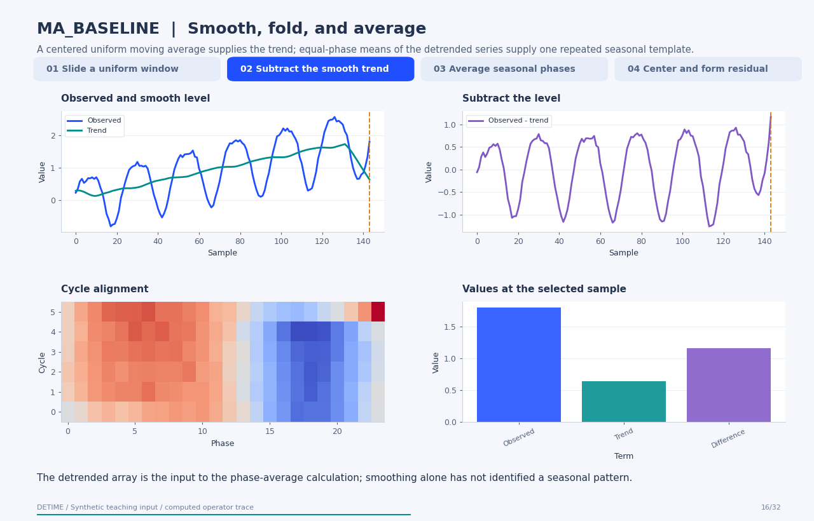
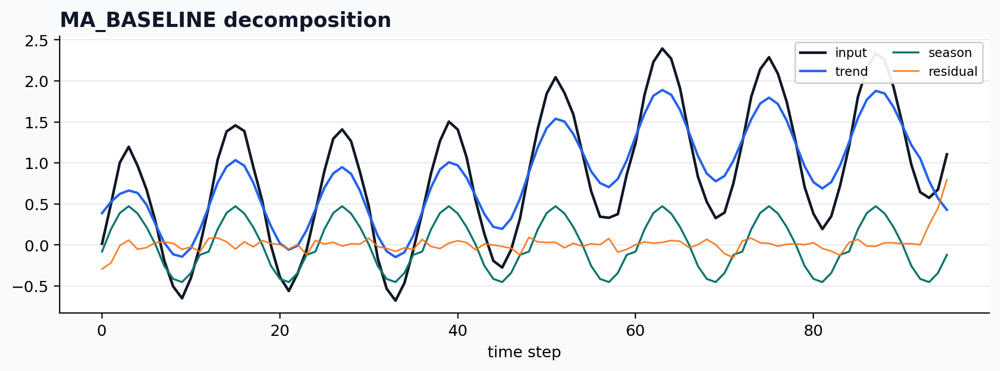

[← All 31 animations](index.md)

<div class="method-detail-header">
  <h1>Moving-average baseline</h1>
  <p>Moving-average baseline</p>
  <svg viewBox="0 0 400 100" xmlns="http://www.w3.org/2000/svg"><g fill="none" stroke-linecap="round"><path d="M0 50 C30 20 60 78 90 42 S150 16 180 52 S240 80 300 34 S360 14 400 50" stroke="#1F4FFF" stroke-width="2.6" stroke-opacity=".28"/><path d="M0 62 C80 58 160 48 240 38 S340 26 400 24" stroke="#00A6A6" stroke-width="2.2" stroke-opacity=".18"/><path d="M0 74 C20 66 40 82 60 72 S100 64 120 74 S160 82 180 72 S220 64 240 74 S300 82 400 68" stroke="#9AA8C7" stroke-width="1.8" stroke-opacity=".14"/></g></svg>
</div>

| Property | Value |
|---|---|
| **Method** | `MA_BASELINE` |
| **Input mode** | `univariate` |
| **Trend shape** | `(96,)` |
| **Notebook execution** | ran |
| **Reconstruction RMSE** | 0.00000000 |

<!-- detime:notebook-metric:start -->
Notebook example metric: root mean square of `input - (trend + season + residual)` over all samples and channels. This checks additive bookkeeping; it is not a forecast error or a component-recovery score. The separate teaching input and intermediate arrays for the animation are linked below.
<!-- detime:notebook-metric:end -->

<!-- detime:method-animation:start -->
## How it works

**Method maturity:** `stable`. **Implementation:** `native-backed`.

A centered uniform moving average supplies the trend; equal-phase means of the detrended series supply one repeated seasonal template.

[](../assets/generated/method-animations/ma-baseline.gif)

Deterministic synthetic teaching signal; not a benchmark.

[Open GIF](../assets/generated/method-animations/ma-baseline.gif) · [Static PNG](../assets/generated/method-animations/ma-baseline.png) · [Source arrays (NPZ)](../assets/generated/method-animations/ma-baseline.npz) · [Trace metadata](../assets/generated/method-animations/ma-baseline.json)

### Follow the four steps

**1. Slide a uniform window**

Use uniform weights over an odd-length window. DeTime increments an even requested window by one. Its NumPy mode='same' convolution uses zero extension at both ends, so the divisor remains the full window length even near an edge.

**2. Subtract the smooth trend**

Compute detrended = observed - trend. Folding this array into cycle rows shows the values that share each seasonal phase.

**3. Average seasonal phases**

For each phase offset, average the detrended values separated by season_period samples. Repeat those means along the record. If season_period is omitted, the seasonal component is identically zero.

**4. Center and form residual**

Subtract the mean of the complete repeated seasonal array, then return residual = observed - trend - season. This guarantees an additive identity without establishing that each assigned component is physically correct.

### Parameters that change the result

| Parameter | Effect on the computation |
|---|---|
| `trend_window` | Smoothing width; even requests are advanced to the next odd integer. The animation uses 25. |
| `season_period` | Spacing between observations assigned to the same seasonal phase; omitted means no seasonal estimate. |

### What this animation computes

Window values, zero extension, uniform weights, phase averages, and centering follow the Python source. Final arrays are checked against the public Python execution path.

### Interpretation

- This is an in-package baseline, not a reproduction of a separately published forecasting model.
- Zero extension pulls endpoint moving averages toward zero. Inspect boundary behavior before using the resulting components.
- One repeated phase template cannot express arbitrary cycle-to-cycle shape changes.
- Centered smoothing and full-record phase averaging use future observations relative to earlier time points; causal forecasting requires an origin-specific pipeline.

### Try the method

Use this configuration with DecompositionConfig and decompose. The animation generator supplies the teaching input and records intermediate arrays.

```json
{
  "method": "MA_BASELINE",
  "backend": "python",
  "params": {
    "trend_window": 25,
    "season_period": 24
  }
}
```

See [the configuration reference](../config-reference.md#ma_baseline) for the full interface and optional dependencies.

### Sources and reproduction

- [DeTime moving-average baseline implementation](https://github.com/systems-mechanobiology/DeTime/blob/main/src/detime/methods/ma_baseline.py)
- [DeTime implementation: `src/detime/methods/ma_baseline.py`](https://github.com/systems-mechanobiology/DeTime/blob/main/src/detime/methods/ma_baseline.py)
- [DeTime implementation: `native/src/ma_baseline.cpp`](https://github.com/systems-mechanobiology/DeTime/blob/main/native/src/ma_baseline.cpp)

Regenerate this animation with `python scripts/generate_method_animations.py --methods MA_BASELINE`.
The [reproduction guide](../maintenance/method-animations.md) explains the environment,
numerical checks, coverage manifest, and how to inspect the stored arrays.
<!-- detime:method-animation:end -->

## Code

```python
case = CASES["MA_BASELINE"]
run_gallery_case("MA_BASELINE")
```

## Output

<div class="gallery-out">
<pre>
MA_BASELINE: Simple moving-average baseline for smoke tests and lightweight workflows.
status: ran
input mode: univariate
trend shape: (96,)
backend: native
reconstruction RMSE: 0.00000000
</pre>
</div>

## Decomposition Plot


