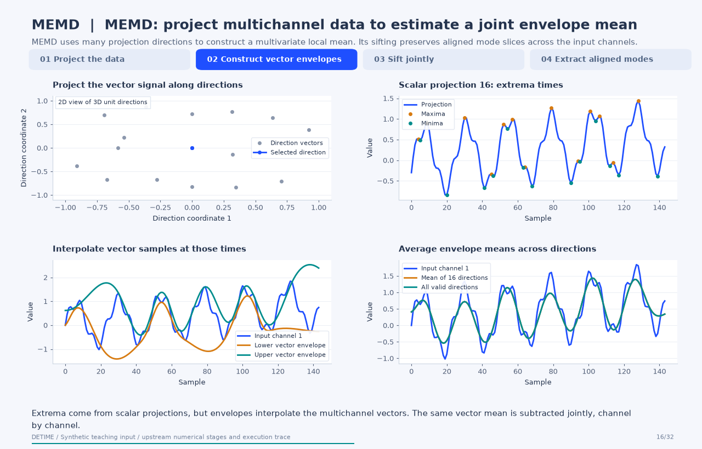
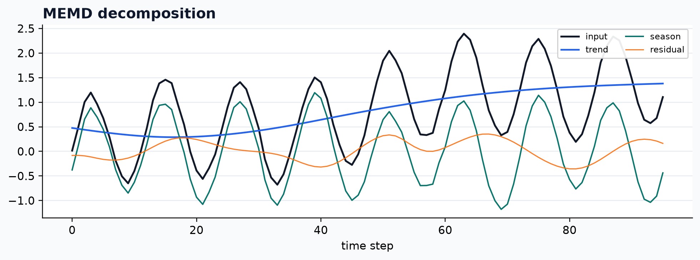

<a class="method-detail-back" href="../../notebook-gallery/">← Back to Gallery</a>

<div class="method-detail-header">
  <h1>Optional multivariate EMD backend</h1>
  <p>Optional multivariate EMD backend</p>
  <svg viewBox="0 0 400 100" xmlns="http://www.w3.org/2000/svg"><g fill="none" stroke-linecap="round"><path d="M0 50 C30 20 60 78 90 42 S150 16 180 52 S240 80 300 34 S360 14 400 50" stroke="#1F4FFF" stroke-width="2.6" stroke-opacity=".28"/><path d="M0 62 C80 58 160 48 240 38 S340 26 400 24" stroke="#00A6A6" stroke-width="2.2" stroke-opacity=".18"/><path d="M0 74 C20 66 40 82 60 72 S100 64 120 74 S160 82 180 72 S220 64 240 74 S300 82 400 68" stroke="#9AA8C7" stroke-width="1.8" stroke-opacity=".14"/></g></svg>
</div>

| Property | Value |
|---|---|
| **Method** | `MEMD` |
| **Input mode** | `multivariate` |
| **Trend shape** | `(96, 3)` |
| **Status** | ran |
| **Residual RMSE** | 0.00000000 |

<!-- detime:method-animation:start -->
## How it works

MEMD uses many projection directions to construct a multivariate local mean. Its sifting preserves aligned mode slices across the input channels.

[](../assets/generated/method-animations/memd.gif)

Deterministic synthetic teaching signal; not a benchmark.

[Open GIF](../assets/generated/method-animations/memd.gif) · [Static PNG](../assets/generated/method-animations/memd.png) · [Source arrays (NPZ)](../assets/generated/method-animations/memd.npz) · [Trace metadata](../assets/generated/method-animations/memd.json)

### Follow the four steps

**1. Project the data**

Use Hammersley-based unit directions and locate extrema of each scalar projection.

**2. Construct vector envelopes**

At the projection extrema times, interpolate the original vector samples and average valid envelopes.

**3. Sift jointly**

Subtract the direction-averaged vector mean and repeat the multivariate stopping test.

**4. Extract aligned modes**

Remove the accepted multichannel IMF, continue on the vector residue, and keep the final residue.

### Parameters that change the result

| Parameter | Effect on the computation |
|---|---|
| `n_dir (upstream trace)` | This bounded PySDKit demonstration uses 16 projection directions; the DeTime wrapper does not expose this as a documented public control. |
| `Stopping rule (upstream trace)` | Uses PySDKit's default Rilling-style test with a safety cap of 50 sifts. |
| `primary_period / explicit mode groups` | Used by DeTime after upstream extraction, independently of the projection directions. |

### What this animation computes

Computed with PySDKit 0.5.0: its direction, extrema, and boundary helpers supply the vector envelopes; actual first-IMF sifting calls are recorded. The reduced direction count is a teaching setting, not a benchmark setting.

### Interpretation

- This PySDKit backend requires at least three channels for MEMD; the example uses three aligned channels.
- Projection count, envelope boundaries, and stopping rules affect the result.
- Aligned IMF indexes do not establish physiological or other physical source identity.

### Try the method

Use this configuration with DecompositionConfig and decompose. The animation generator supplies the teaching input and records intermediate arrays.

```json
{
  "method": "MEMD",
  "params": {
    "primary_period": 24
  },
  "backend": "python"
}
```

See [the configuration reference](../config-reference.md#memd) for the full interface and optional dependencies.

### Sources and reproduction

- [PySDKit MEMD API and implementation](https://pysdkit.readthedocs.io/en/stable/API/pysdkit._emd.html)
- [Rehman and Mandic: Multivariate empirical mode decomposition](https://doi.org/10.1098/rspa.2009.0502)
- [DeTime implementation: `src/detime/methods/memd.py`](https://github.com/systems-mechanobiology/DeTime/blob/main/src/detime/methods/memd.py)
- [DeTime implementation: `src/detime/methods/mvmd.py`](https://github.com/systems-mechanobiology/DeTime/blob/main/src/detime/methods/mvmd.py)

Regenerate this animation with `python scripts/generate_method_animations.py --methods MEMD`.
The [reproduction guide](../maintenance/method-animations.md) explains the environment,
numerical checks, coverage manifest, and how to inspect the stored arrays.
<!-- detime:method-animation:end -->

## Code

```python
case = CASES["MEMD"]
run_gallery_case("MEMD")
```

## Output

<div class="gallery-out">
<pre>
MEMD: Optional multivariate EMD backend
status: ran
...
</pre>
</div>

## Decomposition Plot


