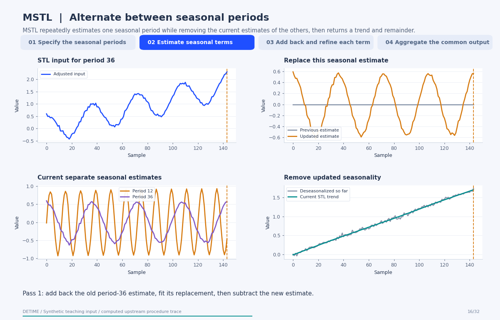
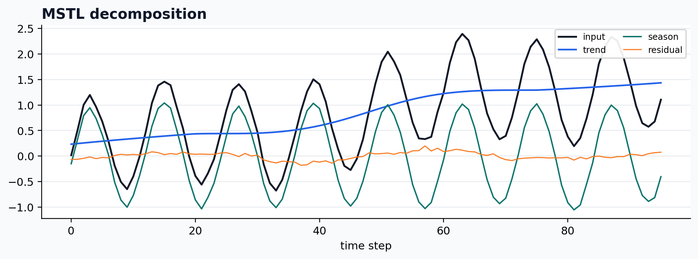

[← All 31 animations](index.md)

<div class="method-detail-header">
  <h1>Statsmodels MSTL wrapper</h1>
  <p>Statsmodels MSTL wrapper</p>
  <svg viewBox="0 0 400 100" xmlns="http://www.w3.org/2000/svg"><g fill="none" stroke-linecap="round"><path d="M0 50 C30 20 60 78 90 42 S150 16 180 52 S240 80 300 34 S360 14 400 50" stroke="#1F4FFF" stroke-width="2.6" stroke-opacity=".28"/><path d="M0 62 C80 58 160 48 240 38 S340 26 400 24" stroke="#00A6A6" stroke-width="2.2" stroke-opacity=".18"/><path d="M0 74 C20 66 40 82 60 72 S100 64 120 74 S160 82 180 72 S220 64 240 74 S300 82 400 68" stroke="#9AA8C7" stroke-width="1.8" stroke-opacity=".14"/></g></svg>
</div>

| Property | Value |
|---|---|
| **Method** | `MSTL` |
| **Input mode** | `univariate` |
| **Trend shape** | `(96,)` |
| **Notebook execution** | ran |
| **Reconstruction RMSE** | 0.00000000 |

<!-- detime:notebook-metric:start -->
Notebook example metric: root mean square of `input - (trend + season + residual)` over all samples and channels. This checks additive bookkeeping; it is not a forecast error or a component-recovery score. The separate teaching input and intermediate arrays for the animation are linked below.
<!-- detime:notebook-metric:end -->

<!-- detime:method-animation:start -->
## How it works

**Method maturity:** `stable`. **Implementation:** `wrapper`.

MSTL repeatedly estimates one seasonal period while removing the current estimates of the others, then returns a trend and remainder.

[](../assets/generated/method-animations/mstl.gif)

Deterministic synthetic teaching signal; not a benchmark.

[Open GIF](../assets/generated/method-animations/mstl.gif) · [Static PNG](../assets/generated/method-animations/mstl.png) · [Source arrays (NPZ)](../assets/generated/method-animations/mstl.npz) · [Trace metadata](../assets/generated/method-animations/mstl.json)

### Follow the four steps

**1. Specify the seasonal periods**

Supply the periods and their seasonal smoothing windows. This synthetic signal contains periods 12 and 36, and both are specified explicitly. The FFT panel describes the input; it is not an automatic period-selection stage in the wrapper.

**2. Estimate seasonal terms**

Initialize seasonal arrays at zero. For each period in the upstream processing order, fit STL to the currently adjusted series and subtract the estimated seasonal term before processing the next period.

**3. Add back and refine each term**

On each later pass, add back the previous estimate for the period being updated, refit that seasonal term, and subtract its replacement. This preserves the other current seasonal estimates while refining one term at a time.

**4. Aggregate the common output**

Use the trend from the last STL fit and subtract it from the deseasonalized series to obtain residual. DeTime sums separate upstream seasonal columns into result.season. This animation uses lmbda=None; transformed fits require the wrapper's documented original-scale allocation.

### Parameters that change the result

| Parameter | Effect on the computation |
|---|---|
| `periods` | One or more integer cycle lengths. Upstream MSTL sorts them and filters periods that are too long for the record. |
| `windows` | Odd seasonal-smoothing spans paired with the periods; this example uses 11 and 15. |
| `iterate` | Number of passes over the seasonal terms; this example uses two. |
| `lmbda` | Optional Box-Cox transform. None keeps the additive trace in the original scale; transformed components cannot be inverted independently and then simply added. |
| `stl_kwargs` | Options forwarded to each STL fit, including its robustness setting. |

### What this animation computes

The alternating STL loop follows the installed statsmodels MSTL.fit procedure with an explicit two-period, no-transform setup. Its separate seasonal estimates, final trend, and public DeTime output are checked numerically.

### Interpretation

- Choose periods with enough observed repetitions. The example is illustrative and does not identify periods from data.
- Closely related periods and smoothing choices can change how variation is allocated between seasonal terms.
- DeTime's common season field is the sum of upstream seasonal columns; individual periods in this animation are instrumented from the upstream procedure.
- For Box-Cox fits, DeTime uses inverse(T) for trend and inverse(T+S)-inverse(T) for combined season, with the remaining difference in residual. This no-transform trace does not animate that nonlinear allocation.

### Try the method

Use this configuration with DecompositionConfig and decompose. The animation generator supplies the teaching input and records intermediate arrays.

```json
{
  "method": "MSTL",
  "backend": "python",
  "params": {
    "periods": [
      12,
      36
    ],
    "windows": [
      11,
      15
    ],
    "iterate": 2,
    "lmbda": null
  }
}
```

See [the configuration reference](../config-reference.md#mstl) for the full interface and optional dependencies.

### Sources and reproduction

- [Bandara, Hyndman, and Bergmeir (2025), MSTL](https://www.inderscience.com/info/e_inarticle.php?artid=143957)
- [statsmodels MSTL implementation contract](https://www.statsmodels.org/stable/generated/statsmodels.tsa.seasonal.MSTL.html)
- [Cleveland et al. (1990), STL: A Seasonal-Trend Decomposition Procedure Based on Loess](https://www.scb.se/contentassets/ca21efb41fee47d293bbee5bf7be7fb3/stl-a-seasonal-trend-decomposition-procedure-based-on-loess.pdf)
- [DeTime implementation: `src/detime/methods/stl.py`](https://github.com/systems-mechanobiology/DeTime/blob/main/src/detime/methods/stl.py)

Regenerate this animation with `python scripts/generate_method_animations.py --methods MSTL`.
The [reproduction guide](../maintenance/method-animations.md) explains the environment,
numerical checks, coverage manifest, and how to inspect the stored arrays.
<!-- detime:method-animation:end -->

## Code

```python
case = CASES["MSTL"]
run_gallery_case("MSTL")
```

## Output

<div class="gallery-out">
<pre>
MSTL: Statsmodels MSTL wrapped into the DeTime workflow surface.
status: ran
input mode: univariate
trend shape: (96,)
backend: python
reconstruction RMSE: 0.00000000
</pre>
</div>

## Decomposition Plot


