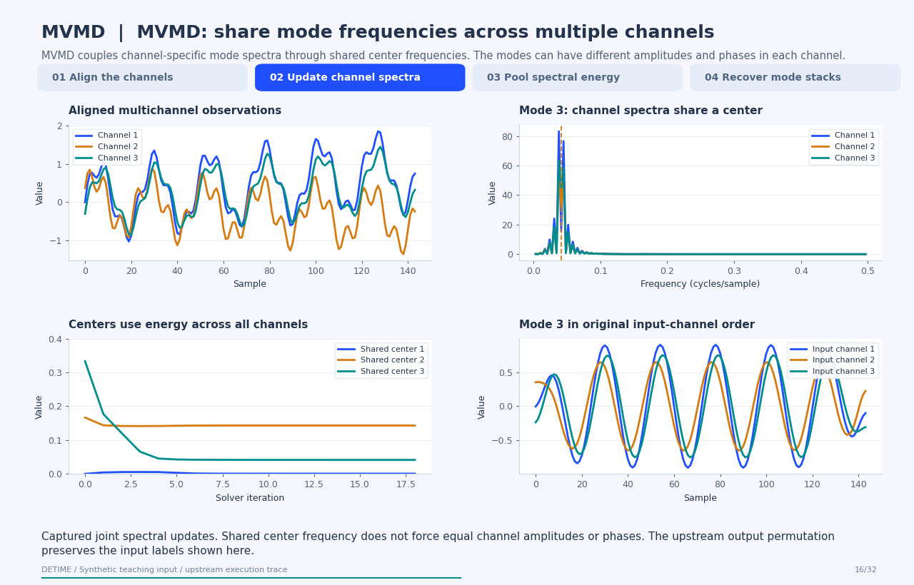
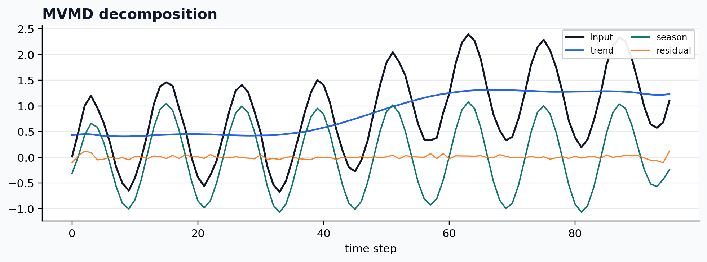

[← All 31 animations](index.md)

<div class="method-detail-header">
  <h1>Optional multivariate VMD backend</h1>
  <p>Optional multivariate VMD backend</p>
  <svg viewBox="0 0 400 100" xmlns="http://www.w3.org/2000/svg"><g fill="none" stroke-linecap="round"><path d="M0 50 C30 20 60 78 90 42 S150 16 180 52 S240 80 300 34 S360 14 400 50" stroke="#1F4FFF" stroke-width="2.6" stroke-opacity=".28"/><path d="M0 62 C80 58 160 48 240 38 S340 26 400 24" stroke="#00A6A6" stroke-width="2.2" stroke-opacity=".18"/><path d="M0 74 C20 66 40 82 60 72 S100 64 120 74 S160 82 180 72 S220 64 240 74 S300 82 400 68" stroke="#9AA8C7" stroke-width="1.8" stroke-opacity=".14"/></g></svg>
</div>

| Property | Value |
|---|---|
| **Method** | `MVMD` |
| **Input mode** | `multivariate` |
| **Trend shape** | `(96, 3)` |
| **Notebook execution** | ran |
| **Reconstruction RMSE** | 0.00000000 |

<!-- detime:notebook-metric:start -->
Notebook example metric: root mean square of `input - (trend + season + residual)` over all samples and channels. This checks additive bookkeeping; it is not a forecast error or a component-recovery score. The separate teaching input and intermediate arrays for the animation are linked below.
<!-- detime:notebook-metric:end -->

<!-- detime:method-animation:start -->
## How it works

**Method maturity:** `optional-backend`. **Implementation:** `optional-backend`.

MVMD couples channel-specific mode spectra through shared center frequencies. The modes can have different amplitudes and phases in each channel.

[](../assets/generated/method-animations/mvmd.gif)

Deterministic synthetic teaching signal; not a benchmark.

[Open GIF](../assets/generated/method-animations/mvmd.gif) · [Static PNG](../assets/generated/method-animations/mvmd.png) · [Source arrays (NPZ)](../assets/generated/method-animations/mvmd.npz) · [Trace metadata](../assets/generated/method-animations/mvmd.json)

### Follow the four steps

**1. Align the channels**

Supply measurements on a common time grid and prepare their mirrored spectra.

**2. Update channel spectra**

Each channel fits a mode around the current shared center.

**3. Pool spectral energy**

Update each center using the spectral energy from all channels, then repeat.

**4. Recover mode stacks**

Invert the spectra and retain the (mode,time,channel) organization before application-specific grouping.

### Parameters that change the result

| Parameter | Effect on the computation |
|---|---|
| `K and alpha` | The teaching run uses three modes and bandwidth penalty 1500. |
| `Upstream trace settings` | Uniform initialization, tau=0, and max_iter=60 bound this PySDKit demonstration; not all are public DeTime parameters. |
| `primary_period / mode groups` | Controls DeTime's assignment of the returned modes to output components. |

### What this animation computes

Captured PySDKit 0.5.0 joint solver arrays on input shaped (channel,time). Internal channels correspond to input indexes [2, 0, 1] (zero-based); applying indexes [1, 2, 0] restores original order in every displayed spectrum and mode. The final trace is checked against the upstream returned modes.

### Interpretation

- The optional backend requires aligned multichannel input and an explicitly checked axis convention.
- PySDKit's all-axis FFT shift changes the internal channel order; its final inverse shift restores input order. The animation applies that same restoration to every displayed iterate.
- A shared mode center does not identify a shared causal source, and tau=0 can leave reconstruction error.

### Try the method

Use this configuration with DecompositionConfig and decompose. The animation generator supplies the teaching input and records intermediate arrays.

```json
{
  "method": "MVMD",
  "params": {
    "K": 3,
    "alpha": 1500.0,
    "primary_period": 24
  },
  "backend": "python"
}
```

See [the configuration reference](../config-reference.md#mvmd) for the full interface and optional dependencies.

### Sources and reproduction

- [PySDKit MVMD interface and implementation](https://pysdkit.readthedocs.io/en/stable/API/pysdkit._vmd.html)
- [Multivariate variational mode decomposition](https://doi.org/10.1109/TSP.2019.2951223)
- [DeTime implementation: `src/detime/methods/mvmd.py`](https://github.com/systems-mechanobiology/DeTime/blob/main/src/detime/methods/mvmd.py)

Regenerate this animation with `python scripts/generate_method_animations.py --methods MVMD`.
The [reproduction guide](../maintenance/method-animations.md) explains the environment,
numerical checks, coverage manifest, and how to inspect the stored arrays.
<!-- detime:method-animation:end -->

## Code

```python
case = CASES["MVMD"]
run_gallery_case("MVMD")
```

## Output

<div class="gallery-out">
<pre>
MVMD: Optional multivariate VMD backend for shared frequency structure.
status: ran
input mode: multivariate
trend shape: (96, 3)
backend: python
reconstruction RMSE: 0.00000000
</pre>
</div>

## Decomposition Plot


