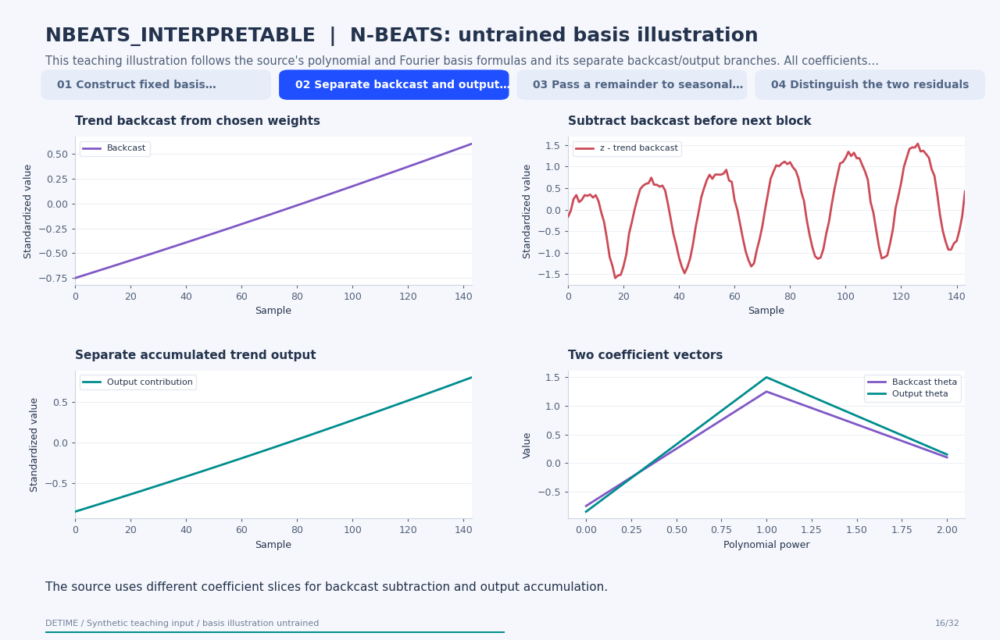

# N-BEATS: untrained basis illustration

[← All 31 animations](index.md)

<!-- detime:method-animation:start -->
## How it works

**Method maturity:** `experimental`. **Implementation:** `python`.

This teaching illustration follows the source's polynomial and Fourier basis formulas and its separate backcast/output branches. All coefficients are explicitly chosen constants. The actual NBEATS_INTERPRETABLE method trains an MLP for each decomposition call using Torch, but that optional backend is not executed for this asset. The animation explains the basis mechanism and residual bookkeeping without presenting an untrained curve as a learned decomposition.

[](../assets/generated/method-animations/nbeats-interpretable.gif)

Deterministic synthetic teaching signal; not a benchmark.

[Open GIF](../assets/generated/method-animations/nbeats-interpretable.gif) · [Static PNG](../assets/generated/method-animations/nbeats-interpretable.png) · [Source arrays (NPZ)](../assets/generated/method-animations/nbeats-interpretable.npz) · [Trace metadata](../assets/generated/method-animations/nbeats-interpretable.json)

### Follow the four steps

**1. Construct fixed basis functions**

The source creates polynomial trend bases and integer Fourier harmonics on a normalized grid from zero to one.

**2. Separate backcast and output weights**

An actual trained block predicts separate coefficients for backcast subtraction and output accumulation. Here both coefficient vectors are explicitly chosen teaching values.

**3. Pass a remainder to seasonal blocks**

Subtract the backcast contribution, then illustrate a seasonal block's separate backcast and output branches using the Fourier bases.

**4. Distinguish the two residuals**

The internal remainder subtracts backcasts. The public wrapper instead derives its residual from the observed input minus the accumulated trend and seasonal outputs.

### Parameters that change the result

| Parameter | Effect on the computation |
|---|---|
| `degree_of_polynomial` | Sets the degree of the trend basis on the normalized full-record grid. |
| `num_harmonics` | Sets integer Fourier harmonics on normalized time; primary_period does not set these frequencies. |
| `trend_blocks / seasonality_blocks` | Set the numbers of residual-processing MLP blocks in an actual Torch execution. |
| `n_epochs / restarts / seed` | Control actual optimization when the optional method is run; they do not generate the fixed coefficients in this animation. |

### What this animation computes

NumPy evaluates the polynomial/Fourier basis formulas with recorded, fixed teaching coefficients. Torch is not required, the public method is not run, and equality to a trained model is not asserted.

### Interpretation

- This is an untrained basis illustration. No neural checkpoint, optimization trace or public-method output is claimed for this asset.
- The example configuration below would train the optional method and will not reproduce the illustration's chosen coefficients.
- The current source standardizes using the full record before applying a prefix loss mask. fit_scope='prefix' therefore must not be described as leakage-free forecasting.
- The source fits a decomposition to one supplied series. Its same-length outputs do not establish generalization to unseen future observations.
- The public residual is recomputed from the named outputs and differs from the internal remainder produced by subtracting backcasts.

### Try the method

The configuration below runs the optional Torch-based fitting path. It is a separate experiment from this GIF, whose basis coefficients were chosen explicitly for teaching. Reproduce the pictured coefficients with the animation generator and inspect them in the source-array archive.

```json
{
  "method": "NBEATS_INTERPRETABLE",
  "backend": "python",
  "params": {
    "degree_of_polynomial": 2,
    "num_harmonics": 6,
    "trend_blocks": 1,
    "seasonality_blocks": 1,
    "layers": 1,
    "layer_size": 16,
    "fit_scope": "full",
    "n_epochs": 30,
    "restarts": 1,
    "device": "cpu",
    "seed": 42
  }
}
```

See [the configuration reference](../config-reference.md#nbeats_interpretable) for the full interface and optional dependencies.

### Sources and reproduction

- [Implemented DeTime operator](https://github.com/systems-mechanobiology/DeTime/blob/main/src/detime/methods/neural_blocks/learned_priors.py)
- [Oreshkin et al. (2020), N-BEATS: Neural basis expansion analysis for interpretable time series forecasting](https://openreview.net/forum?id=r1ecqn4YwB)
- [DeTime implementation: `src/detime/methods/neural_blocks/learned_priors.py`](https://github.com/systems-mechanobiology/DeTime/blob/main/src/detime/methods/neural_blocks/learned_priors.py)

Regenerate this animation with `python scripts/generate_method_animations.py --methods NBEATS_INTERPRETABLE`.
The [reproduction guide](../maintenance/method-animations.md) explains the environment,
numerical checks, coverage manifest, and how to inspect the stored arrays.
<!-- detime:method-animation:end -->
