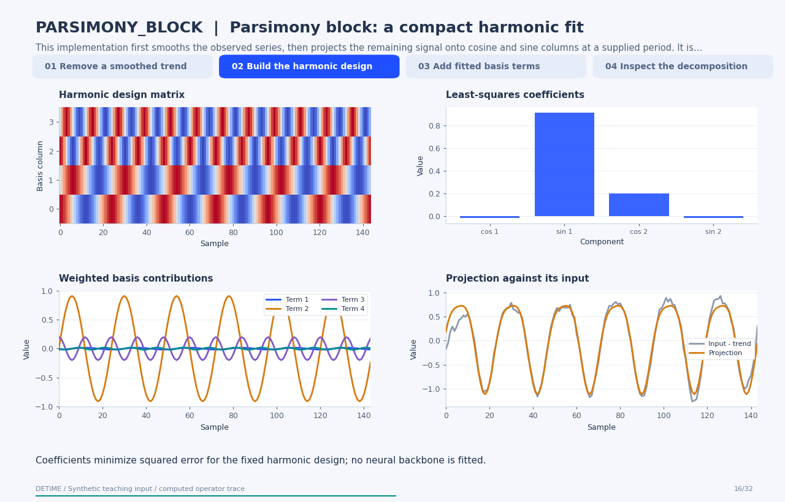

# Parsimony block: a compact harmonic fit

[← All 31 animations](index.md)

<!-- detime:method-animation:start -->
## How it works

**Method maturity:** `experimental`. **Implementation:** `python`.

This implementation first smooths the observed series, then projects the remaining signal onto cosine and sine columns at a supplied period. It is a fixed-basis least-squares operator. The trace makes the design matrix, fitted coefficients and additive contributions visible; it does not reproduce a complete forecasting architecture from the cited paper.

[](../assets/generated/method-animations/parsimony-block.gif)

Deterministic synthetic teaching signal; not a benchmark.

[Open GIF](../assets/generated/method-animations/parsimony-block.gif) · [Static PNG](../assets/generated/method-animations/parsimony-block.png) · [Source arrays (NPZ)](../assets/generated/method-animations/parsimony-block.npz) · [Trace metadata](../assets/generated/method-animations/parsimony-block.json)

### Follow the four steps

**1. Remove a smoothed trend**

Estimate the trend with a 25-sample centered mean, then form the signal to project onto harmonic basis functions.

**2. Build the harmonic design**

Create cosine and sine columns at the requested period and its harmonics, and solve their coefficients by ordinary least squares.

**3. Add fitted basis terms**

The animation adds the already fitted weighted basis terms. This is an algebraic construction, not an optimization trajectory.

**4. Inspect the decomposition**

The trend, harmonic projection and remaining residual match the registered standalone operator.

### Parameters that change the result

| Parameter | Effect on the computation |
|---|---|
| `trend_window` | Controls which structure remains after centered trend smoothing. |
| `primary_period` | Sets the base harmonic period in sample units. |
| `num_harmonics` | Adds paired cosine/sine columns. More terms increase representational capacity without guaranteeing better identification. |
| `fit_scope` | The example uses the complete record. Prefix fitting estimates coefficients on the chosen prefix and evaluates the basis over the record. |

### What this animation computes

Intermediate arrays are computed with the implemented operator helpers. The final trend, season and residual are checked against public decompose(). The animation explains this standalone experimental block; its source architecture is cited for provenance.

### Interpretation

- The harmonic coefficients are fitted numerically, but this standalone operator has no trained neural backbone.
- Changing the supplied period changes the basis. The algorithm does not establish that the period is physically correct.
- The visual addition of basis terms is not the temporal sequence of a training algorithm.
- Full-record smoothing and fitting require an appropriate information boundary before downstream forecasting.

### Try the method

Use this configuration with DecompositionConfig and decompose. The animation generator supplies the teaching input and records intermediate arrays.

```json
{
  "method": "PARSIMONY_BLOCK",
  "params": {
    "primary_period": 24,
    "trend_window": 25,
    "num_harmonics": 2,
    "fit_scope": "full"
  },
  "backend": "python"
}
```

See [the configuration reference](../config-reference.md#parsimony_block) for the full interface and optional dependencies.

### Sources and reproduction

- [Implemented DeTime operator](https://github.com/systems-mechanobiology/DeTime/blob/main/src/detime/methods/neural_blocks/neural_block_portfolio.py)
- [Deng et al. (2024), Parsimony or Capability? Decomposition Delivers Both in Long-term Time Series Forecasting](https://arxiv.org/abs/2401.11929)
- [DeTime implementation: `src/detime/methods/neural_blocks/neural_block_portfolio.py`](https://github.com/systems-mechanobiology/DeTime/blob/main/src/detime/methods/neural_blocks/neural_block_portfolio.py)

Regenerate this animation with `python scripts/generate_method_animations.py --methods PARSIMONY_BLOCK`.
The [reproduction guide](../maintenance/method-animations.md) explains the environment,
numerical checks, coverage manifest, and how to inspect the stored arrays.
<!-- detime:method-animation:end -->
