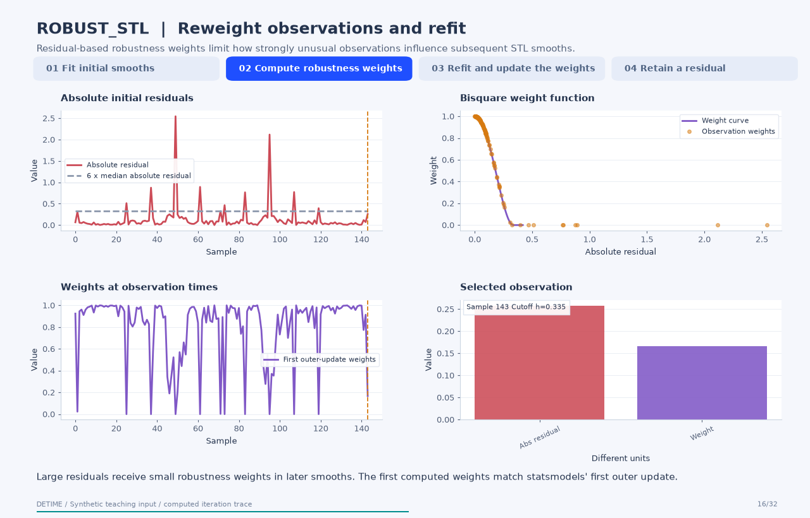
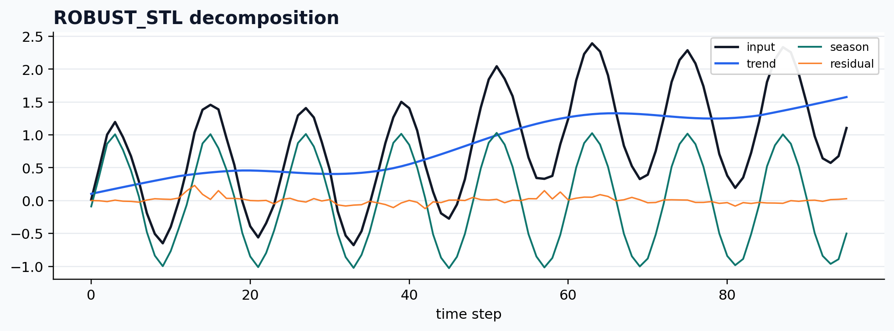

<a class="method-detail-back" href="../../notebook-gallery/">← Back to Gallery</a>

<div class="method-detail-header">
  <h1>Robust STL wrapper</h1>
  <p>Robust STL wrapper</p>
  <svg viewBox="0 0 400 100" xmlns="http://www.w3.org/2000/svg"><g fill="none" stroke-linecap="round"><path d="M0 50 C30 20 60 78 90 42 S150 16 180 52 S240 80 300 34 S360 14 400 50" stroke="#1F4FFF" stroke-width="2.6" stroke-opacity=".28"/><path d="M0 62 C80 58 160 48 240 38 S340 26 400 24" stroke="#00A6A6" stroke-width="2.2" stroke-opacity=".18"/><path d="M0 74 C20 66 40 82 60 72 S100 64 120 74 S160 82 180 72 S220 64 240 74 S300 82 400 68" stroke="#9AA8C7" stroke-width="1.8" stroke-opacity=".14"/></g></svg>
</div>

| Property | Value |
|---|---|
| **Method** | `ROBUST_STL` |
| **Input mode** | `univariate` |
| **Trend shape** | `(96,)` |
| **Status** | ran |
| **Residual RMSE** | 0.00000000 |

<!-- detime:method-animation:start -->
## How it works

Residual-based robustness weights limit how strongly unusual observations influence subsequent STL smooths.

[](../assets/generated/method-animations/robust-stl.gif)

Deterministic synthetic teaching signal; not a benchmark.

[Open GIF](../assets/generated/method-animations/robust-stl.gif) · [Static PNG](../assets/generated/method-animations/robust-stl.png) · [Source arrays (NPZ)](../assets/generated/method-animations/robust-stl.npz) · [Trace metadata](../assets/generated/method-animations/robust-stl.json)

### Follow the four steps

**1. Fit initial smooths**

DeTime's ROBUST_STL selects statsmodels STL with robust=True by default. The initial inner loop estimates seasonal and trend structure before robustness weights are updated.

**2. Compute robustness weights**

The first outer update uses absolute residuals from the initial fit. With h equal to six times their median, the bisquare rule assigns (1 - (abs(residual)/h)^2)^2 below h and zero above h. This example computes those weights and checks them against statsmodels.

**3. Refit and update the weights**

Repeated outer iterations recalculate robustness weights and refit seasonal and trend smooths. Each shown checkpoint is a fresh deterministic statsmodels fit with the indicated iteration budget; it reaches the same state for that budget.

**4. Retain a residual**

The wrapper returns the final trend, seasonal component, and residual. Downweighted observations remain in the input, so their unexplained values appear in the residual. The animation also displays upstream weights, which the current DeTime wrapper does not export as a result component.

### Parameters that change the result

| Parameter | Effect on the computation |
|---|---|
| `period` | Specified number of samples in a seasonal cycle; this example uses 12. |
| `seasonal` | Odd LOESS span across cycles for the seasonal subseries; smaller spans allow faster seasonal change. |
| `trend / low_pass` | Odd smoothing spans controlling trend and low-pass behavior; this example uses 23 and 13. |
| `robust` | Controls the outer reweighting loop. ROBUST_STL defaults to True; setting it False disables robustness. |

### What this animation computes

All robustness weights and iteration checkpoints are computed from statsmodels; the first bisquare update is independently calculated and compared. Final arrays match DeTime's Python wrapper.

### Interpretation

- ROBUST_STL is the registry name for statsmodels STL with its robust option. This name does not establish implementation of other published algorithms also called RobustSTL.
- Smoothing spans, seasonal period, endpoint handling, and outliers influence the estimated components.
- The animation uses statsmodels' actual checkpoints. Internal fits are restarted for each budget; frame count is not an execution-time measure.
- STL is an offline smoother. Use only available history when constructing forecasting features.

### Try the method

Use this configuration with DecompositionConfig and decompose. The animation generator supplies the teaching input and records intermediate arrays.

```json
{
  "method": "ROBUST_STL",
  "backend": "python",
  "params": {
    "period": 12,
    "seasonal": 7,
    "trend": 23,
    "low_pass": 13,
    "robust": true
  }
}
```

See [the configuration reference](../config-reference.md#robust_stl) for the full interface and optional dependencies.

### Sources and reproduction

- [Cleveland et al. (1990), STL: A Seasonal-Trend Decomposition Procedure Based on Loess](https://www.scb.se/contentassets/ca21efb41fee47d293bbee5bf7be7fb3/stl-a-seasonal-trend-decomposition-procedure-based-on-loess.pdf)
- [statsmodels STL: parameters and implementation contract](https://www.statsmodels.org/stable/generated/statsmodels.tsa.seasonal.STL.html)
- [DeTime implementation: `src/detime/methods/stl.py`](https://github.com/systems-mechanobiology/DeTime/blob/main/src/detime/methods/stl.py)

Regenerate this animation with `python scripts/generate_method_animations.py --methods ROBUST_STL`.
The [reproduction guide](../maintenance/method-animations.md) explains the environment,
numerical checks, coverage manifest, and how to inspect the stored arrays.
<!-- detime:method-animation:end -->

## Code

```python
case = CASES["ROBUST_STL"]
run_gallery_case("ROBUST_STL")
```

## Output

<div class="gallery-out">
<pre>
ROBUST_STL: Robust STL wrapper
status: ran
...
</pre>
</div>

## Decomposition Plot


