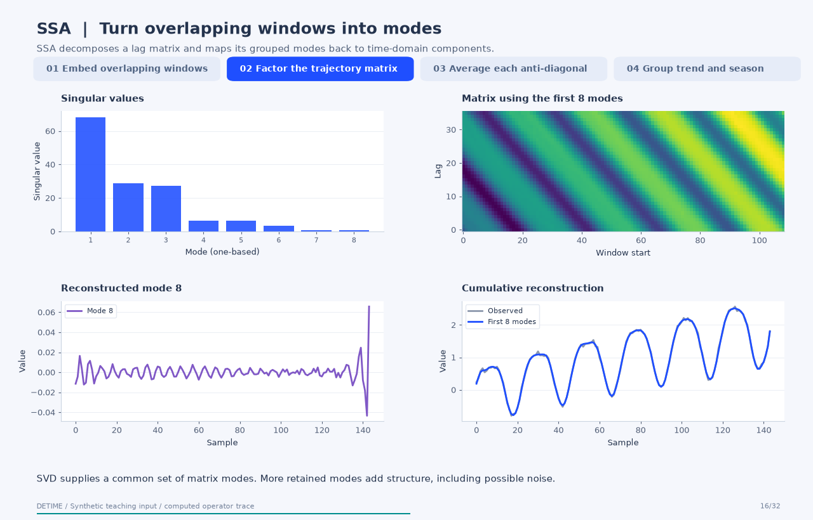
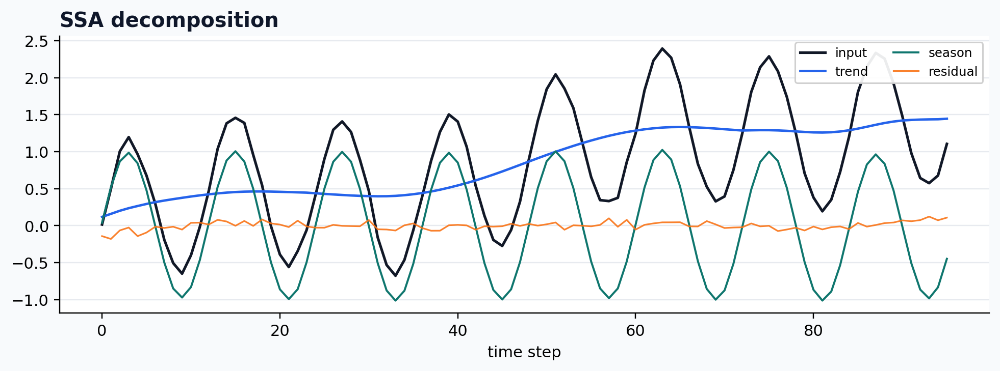

<a class="method-detail-back" href="../../notebook-gallery/">← Back to Gallery</a>

<div class="method-detail-header">
  <h1>Univariate SSA</h1>
  <p>Univariate SSA</p>
  <svg viewBox="0 0 400 100" xmlns="http://www.w3.org/2000/svg"><g fill="none" stroke-linecap="round"><path d="M0 50 C30 20 60 78 90 42 S150 16 180 52 S240 80 300 34 S360 14 400 50" stroke="#1F4FFF" stroke-width="2.6" stroke-opacity=".28"/><path d="M0 62 C80 58 160 48 240 38 S340 26 400 24" stroke="#00A6A6" stroke-width="2.2" stroke-opacity=".18"/><path d="M0 74 C20 66 40 82 60 72 S100 64 120 74 S160 82 180 72 S220 64 240 74 S300 82 400 68" stroke="#9AA8C7" stroke-width="1.8" stroke-opacity=".14"/></g></svg>
</div>

| Property | Value |
|---|---|
| **Method** | `SSA` |
| **Input mode** | `univariate` |
| **Trend shape** | `(96,)` |
| **Status** | ran |
| **Residual RMSE** | 0.00000000 |

<!-- detime:method-animation:start -->
## How it works

SSA decomposes a lag matrix and maps its grouped modes back to time-domain components.

[](../assets/generated/method-animations/ssa.gif)

Deterministic synthetic teaching signal; not a benchmark.

[Open GIF](../assets/generated/method-animations/ssa.gif) · [Static PNG](../assets/generated/method-animations/ssa.png) · [Source arrays (NPZ)](../assets/generated/method-animations/ssa.npz) · [Trace metadata](../assets/generated/method-animations/ssa.json)

### Follow the four steps

**1. Embed overlapping windows**

Slide an L-sample window across the series. Put each window in a column. Repeated observations lie on anti-diagonals, which is the Hankel structure used by SSA.

**2. Factor the trajectory matrix**

Compute X = U diag(s) V^T. Each singular triplet gives one rank-one matrix. Retaining only a chosen number of modes determines which matrix structure can enter subsequent grouping.

**3. Average each anti-diagonal**

A rank-one matrix need not itself be Hankel. Average its anti-diagonals to turn its repeated time-index estimates back into one time-domain reconstructed component.

**4. Group trend and season**

This example uses DeTime's primary-period frequency heuristic. Low-frequency modes are assigned to trend and modes near 1/period to season, with documented fallbacks if a group is empty. Residual is the observed input minus those two groups. Explicit component-index lists can replace this automatic grouping.

### Parameters that change the result

| Parameter | Effect on the computation |
|---|---|
| `window` | Embedding length L; changes the temporal scale and matrix dimensions. |
| `rank` | Number of singular modes available for grouping; more modes can retain both signal structure and noise. |
| `primary_period` | Target period for the frequency-based seasonal grouping heuristic. |
| `trend_components / season_components` | Optional zero-based mode indices that explicitly define the groups. |
| `season_freq_tol_ratio / trend_freq_threshold` | Control the frequency bands used by automatic grouping. |

### What this animation computes

The trajectory matrix, exact SVD, reconstructed modes, and grouped outputs are computed from the source algorithm. Checks compare trace modes and final groups with the configured Python implementation. The animation explains construction order, not solver wall-clock execution.

### Interpretation

- The labels trend and season come from a grouping rule; singular-value order alone does not establish physical meaning.
- Changing window, rank, or grouping can change components even when additive reconstruction remains exact.
- The animation uses backend='python', speed_mode='exact'. Native or randomized fast paths are separate numerical execution choices.
- This is an offline decomposition. Forecasting features must be recomputed using only observations available at each forecast origin.

### Try the method

Use this configuration with DecompositionConfig and decompose. The animation generator supplies the teaching input and records intermediate arrays.

```json
{
  "method": "SSA",
  "backend": "python",
  "speed_mode": "exact",
  "params": {
    "window": 36,
    "rank": 8,
    "primary_period": 24
  }
}
```

See [the configuration reference](../config-reference.md#ssa) for the full interface and optional dependencies.

### Sources and reproduction

- [Golyandina and Zhigljavsky (2020), Singular Spectrum Analysis for Time Series](https://link.springer.com/book/10.1007/978-3-662-62436-4)
- [DeTime implementation: `src/detime/methods/ssa.py`](https://github.com/systems-mechanobiology/DeTime/blob/main/src/detime/methods/ssa.py)
- [DeTime implementation: `native/src/ssa.cpp`](https://github.com/systems-mechanobiology/DeTime/blob/main/native/src/ssa.cpp)
- [DeTime implementation: `src/detime/methods/utils.py`](https://github.com/systems-mechanobiology/DeTime/blob/main/src/detime/methods/utils.py)

Regenerate this animation with `python scripts/generate_method_animations.py --methods SSA`.
The [reproduction guide](../maintenance/method-animations.md) explains the environment,
numerical checks, coverage manifest, and how to inspect the stored arrays.
<!-- detime:method-animation:end -->

## Code

```python
case = CASES["SSA"]
run_gallery_case("SSA")
```

## Output

<div class="gallery-out">
<pre>
SSA: Univariate SSA
status: ran
...
</pre>
</div>

## Decomposition Plot


