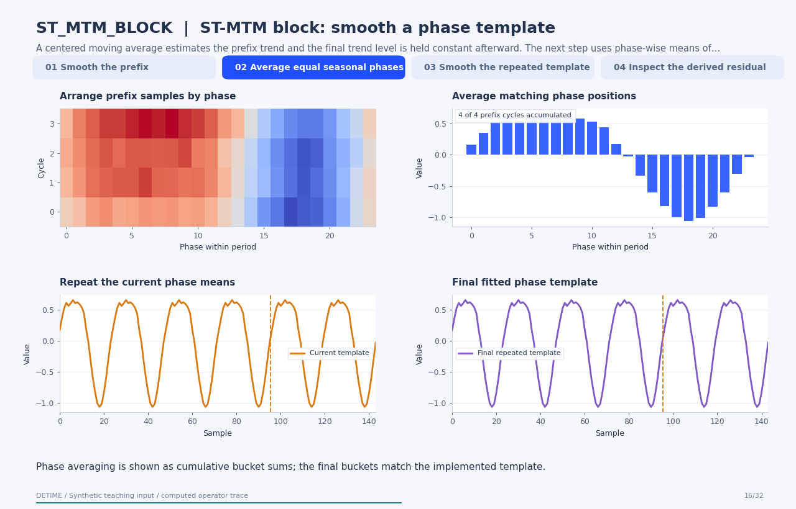

# ST-MTM block: smooth a phase template

[← All 31 animations](index.md)

<!-- detime:method-animation:start -->
## How it works

**Method maturity:** `experimental`. **Implementation:** `python`.

A centered moving average estimates the prefix trend and the final trend level is held constant afterward. The next step uses phase-wise means of the detrended prefix. The frames expose those buckets, their cumulative averages and the repeated seasonal output. The computation shown has a smoothed template. It does not perform masked-time-series pretraining.

[](../assets/generated/method-animations/st-mtm-block.gif)

Deterministic synthetic teaching signal; not a benchmark.

[Open GIF](../assets/generated/method-animations/st-mtm-block.gif) · [Static PNG](../assets/generated/method-animations/st-mtm-block.png) · [Source arrays (NPZ)](../assets/generated/method-animations/st-mtm-block.npz) · [Trace metadata](../assets/generated/method-animations/st-mtm-block.json)

### Follow the four steps

**1. Smooth the prefix**

A centered moving average estimates the prefix trend and the final trend level is held constant afterward.

**2. Average equal seasonal phases**

Subtract the trend on the fitting prefix. Group samples by index modulo the specified period and average each phase bucket.

**3. Smooth the repeated template**

Tile the fitted phase means over the record. The ST-MTM variant additionally smooths that repeated curve with a centered mean.

**4. Inspect the derived residual**

Compute input minus the implemented trend and seasonal estimate. This residual is part of a retrospective decomposition, not a forecast score.

### Parameters that change the result

| Parameter | Effect on the computation |
|---|---|
| `trend_window` | Sets the centered moving-average support on the prefix; its endpoint is extended as a constant. |
| `primary_period` | Defines phase buckets in samples; the fitting prefix must contain enough cycles for an interpretable average. |
| `fit_scope / train_fraction` | Explicitly selects a two-thirds prefix in this example; it does not create a rolling forecasting evaluation. |
| `season_smooth_window` | Smooths the tiled phase estimate. It changes amplitudes and edge values after bucket averaging. |

### What this animation computes

Intermediate arrays are computed with the implemented operator helpers. The final trend, season and residual are checked against public decompose(). The animation explains this standalone experimental block; its source architecture is cited for provenance.

### Interpretation

- The computation shown has a smoothed template. It does not perform masked-time-series pretraining.
- Prefix fitting is a fixed fitting convention. It does not certify rolling causality or an out-of-sample prediction experiment.
- A repeated phase template assumes that the fitted seasonal shape remains useful over the displayed suffix.
- The residual is derived by subtraction; exact reconstruction does not validate the scientific interpretation of either component.

### Try the method

Use this configuration with DecompositionConfig and decompose. The animation generator supplies the teaching input and records intermediate arrays.

```json
{
  "method": "ST_MTM_BLOCK",
  "params": {
    "primary_period": 24,
    "fit_scope": "prefix",
    "train_fraction": 0.6666666666666666,
    "trend_window": 49,
    "season_smooth_window": 13
  },
  "backend": "python"
}
```

See [the configuration reference](../config-reference.md#st_mtm_block) for the full interface and optional dependencies.

### Sources and reproduction

- [Implemented DeTime operator](https://github.com/systems-mechanobiology/DeTime/blob/main/src/detime/methods/neural_blocks/neural_block_portfolio.py)
- [Seo and Lim (2025), ST-MTM: Masked Time Series Modeling with Seasonal-Trend Decomposition for Time Series Forecasting](https://arxiv.org/abs/2507.00013)
- [DeTime implementation: `src/detime/methods/neural_blocks/neural_block_portfolio.py`](https://github.com/systems-mechanobiology/DeTime/blob/main/src/detime/methods/neural_blocks/neural_block_portfolio.py)

Regenerate this animation with `python scripts/generate_method_animations.py --methods ST_MTM_BLOCK`.
The [reproduction guide](../maintenance/method-animations.md) explains the environment,
numerical checks, coverage manifest, and how to inspect the stored arrays.
<!-- detime:method-animation:end -->
