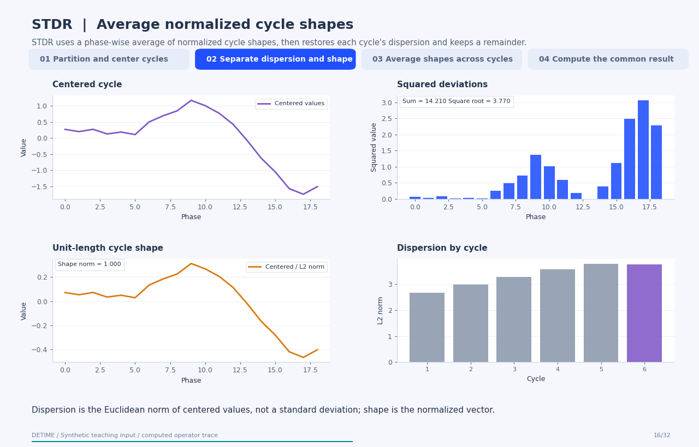
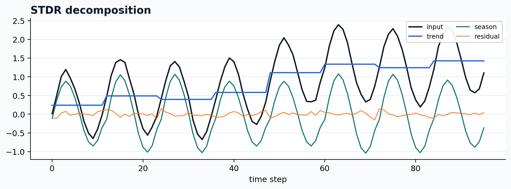

[← All 31 animations](index.md)

<div class="method-detail-header">
  <h1>Seasonal-trend-dispersion decomposition with a remainder</h1>
  <p>Seasonal-trend-dispersion decomposition with a remainder</p>
  <svg viewBox="0 0 400 100" xmlns="http://www.w3.org/2000/svg"><g fill="none" stroke-linecap="round"><path d="M0 50 C30 20 60 78 90 42 S150 16 180 52 S240 80 300 34 S360 14 400 50" stroke="#1F4FFF" stroke-width="2.6" stroke-opacity=".28"/><path d="M0 62 C80 58 160 48 240 38 S340 26 400 24" stroke="#00A6A6" stroke-width="2.2" stroke-opacity=".18"/><path d="M0 74 C20 66 40 82 60 72 S100 64 120 74 S160 82 180 72 S220 64 240 74 S300 82 400 68" stroke="#9AA8C7" stroke-width="1.8" stroke-opacity=".14"/></g></svg>
</div>

| Property | Value |
|---|---|
| **Method** | `STDR` |
| **Input mode** | `channelwise` |
| **Trend shape** | `(96,)` |
| **Notebook execution** | ran |
| **Reconstruction RMSE** | 0.00000000 |

<!-- detime:notebook-metric:start -->
Notebook example metric: root mean square of `input - (trend + season + residual)` over all samples and channels. This checks additive bookkeeping; it is not a forecast error or a component-recovery score. The separate teaching input and intermediate arrays for the animation are linked below.
<!-- detime:notebook-metric:end -->

<!-- detime:method-animation:start -->
## How it works

**Method maturity:** `maintained`. **Implementation:** `native-backed`.

STDR uses a phase-wise average of normalized cycle shapes, then restores each cycle's dispersion and keeps a remainder.

[](../assets/generated/method-animations/stdr.gif)

Deterministic synthetic teaching signal; not a benchmark.

[Open GIF](../assets/generated/method-animations/stdr.gif) · [Static PNG](../assets/generated/method-animations/stdr.png) · [Source arrays (NPZ)](../assets/generated/method-animations/stdr.npz) · [Trace metadata](../assets/generated/method-animations/stdr.json)

### Follow the four steps

**1. Partition and center cycles**

Split at the configured period, compute each block's arithmetic mean, and subtract it. DeTime assigns that mean to every sample of the block, producing a piecewise-constant trend. A final partial block uses the samples that exist.

**2. Separate dispersion and shape**

Compute the Euclidean norm of each centered block as its dispersion. Divide by that norm to obtain a unit-length seasonal shape. A block whose norm is below eps receives zero dispersion and a zero shape.

**3. Average shapes across cycles**

Average normalized shape entries at the same phase across cycles. For a partial cycle, increment counts only for available phases. Multiply this shared average by each cycle's own dispersion; the average shape is not normalized again.

**4. Compute the common result**

Return trend, the scaled seasonal term, and residual = observed - trend - season, plus dispersion and seasonal-shape arrays. Deviations from the common cycle shape remain in the residual. In the cited formulation, R denotes a remainder; the code does not perform robust reweighting.

### Parameters that change the result

| Parameter | Effect on the computation |
|---|---|
| `period` | Block length and seasonal phase convention; a wrong period changes levels, scales, and shape alignment. |
| `eps` | Threshold below which a centered block is treated as having zero dispersion. |
| `max_period_search` | Upper bound on the FFT-based period heuristic used only when period is omitted; this animation supplies the period explicitly. |

### What this animation computes

Every stage follows compute_std_components and the corresponding native kernel: block means, Euclidean norms, phase counts, and scaling. Both direct-source and public Python outputs are compared. The final short block is intentional.

### Interpretation

- DeTime's STD/STDR use block means and L2 norms. Dispersion is not the sample standard deviation.
- STDR uses ordinary phase-wise means of normalized shapes. No robust loss, trimming, or outlier weights are used in this implementation.
- A partial cycle has its own mean and norm and contributes only available phases; its scale is not directly comparable to a full cycle without accounting for length.
- STD retains within-cycle irregular variation in its shape. STDR assigns deviations from a shared shape to the remainder.
- The supplied period and the starting phase define block boundaries; shifting the start changes the decomposition.

### Try the method

Use this configuration with DecompositionConfig and decompose. The animation generator supplies the teaching input and records intermediate arrays.

```json
{
  "method": "STDR",
  "backend": "python",
  "params": {
    "period": 24
  }
}
```

See [the configuration reference](../config-reference.md#stdr) for the full interface and optional dependencies.

### Sources and reproduction

- [Dudek (2022), STD: A Seasonal-Trend-Dispersion Decomposition of Time Series](https://arxiv.org/abs/2204.10398)
- [DeTime implementation: `src/detime/methods/std.py`](https://github.com/systems-mechanobiology/DeTime/blob/main/src/detime/methods/std.py)
- [DeTime implementation: `native/src/std.cpp`](https://github.com/systems-mechanobiology/DeTime/blob/main/native/src/std.cpp)

Regenerate this animation with `python scripts/generate_method_animations.py --methods STDR`.
The [reproduction guide](../maintenance/method-animations.md) explains the environment,
numerical checks, coverage manifest, and how to inspect the stored arrays.
<!-- detime:method-animation:end -->

## Code

```python
case = CASES["STDR"]
run_gallery_case("STDR")
```

## Output

<div class="gallery-out">
<pre>
STDR: Seasonal-trend-dispersion decomposition with an averaged cycle shape and a remainder.
status: ran
input mode: channelwise
trend shape: (96,)
backend: native
reconstruction RMSE: 0.00000000
</pre>
</div>

## Decomposition Plot


