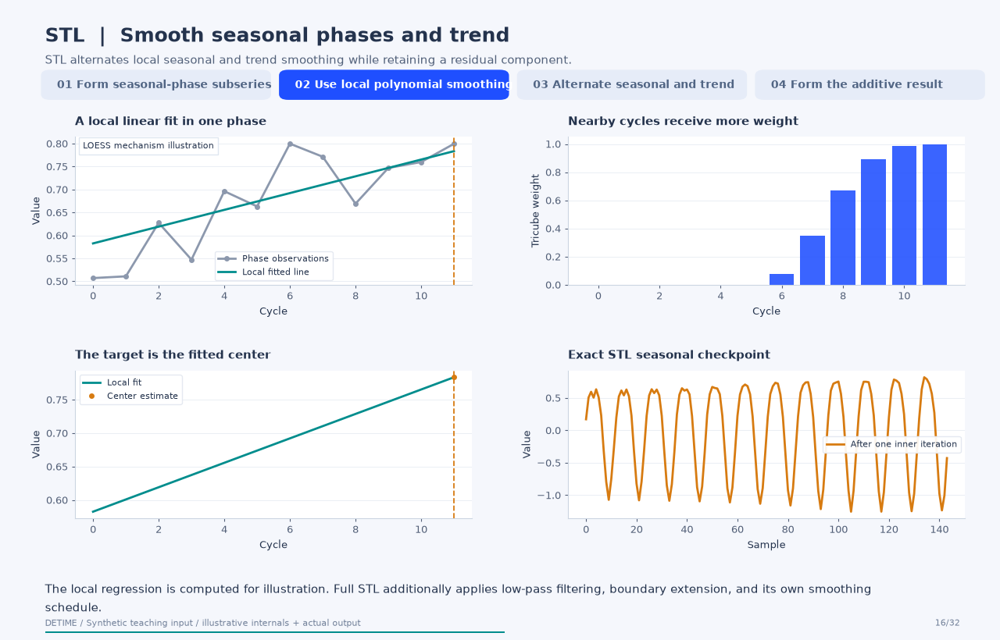
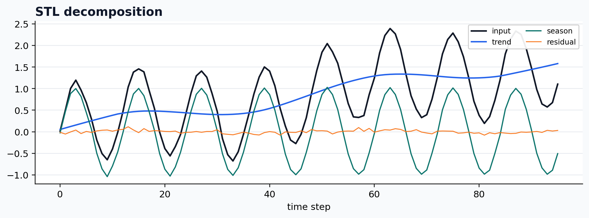

<a class="method-detail-back" href="../../notebook-gallery/">← Back to Gallery</a>

<div class="method-detail-header">
  <h1>Statsmodels STL wrapper</h1>
  <p>Statsmodels STL wrapper</p>
  <svg viewBox="0 0 400 100" xmlns="http://www.w3.org/2000/svg"><g fill="none" stroke-linecap="round"><path d="M0 50 C30 20 60 78 90 42 S150 16 180 52 S240 80 300 34 S360 14 400 50" stroke="#1F4FFF" stroke-width="2.6" stroke-opacity=".28"/><path d="M0 62 C80 58 160 48 240 38 S340 26 400 24" stroke="#00A6A6" stroke-width="2.2" stroke-opacity=".18"/><path d="M0 74 C20 66 40 82 60 72 S100 64 120 74 S160 82 180 72 S220 64 240 74 S300 82 400 68" stroke="#9AA8C7" stroke-width="1.8" stroke-opacity=".14"/></g></svg>
</div>

| Property | Value |
|---|---|
| **Method** | `STL` |
| **Input mode** | `univariate` |
| **Trend shape** | `(96,)` |
| **Status** | ran |
| **Residual RMSE** | 0.00000000 |

<!-- detime:method-animation:start -->
## How it works

STL alternates local seasonal and trend smoothing while retaining a residual component.

[](../assets/generated/method-animations/stl.gif)

Deterministic synthetic teaching signal; not a benchmark.

[Open GIF](../assets/generated/method-animations/stl.gif) · [Static PNG](../assets/generated/method-animations/stl.png) · [Source arrays (NPZ)](../assets/generated/method-animations/stl.npz) · [Trace metadata](../assets/generated/method-animations/stl.json)

### Follow the four steps

**1. Form seasonal-phase subseries**

After removing the current trend, collect values at the same phase in successive cycles. STL smooths along each of these subseries, allowing the seasonal pattern to vary through the record.

**2. Use local polynomial smoothing**

The illustrative panel computes a tricube-weighted local linear fit for one phase. Full STL also extends boundaries, applies low-pass filtering, and combines the smoothed subseries; the illustration is not a replacement implementation of those internals.

**3. Alternate seasonal and trend**

The seasonal estimate is subtracted to form a deseasonalized series, which is smoothed for trend. The numerical checkpoints come from exact statsmodels fits with one through five inner iterations and no outer robustness loop.

**4. Form the additive result**

The final five-iteration checkpoint matches the configured DeTime STL wrapper. Residual is the input minus the returned trend and seasonal component. Reconstruction consistency does not validate a unique physical interpretation.

### Parameters that change the result

| Parameter | Effect on the computation |
|---|---|
| `period` | Specified number of samples in a seasonal cycle; this example uses 12. |
| `seasonal` | Odd LOESS span across cycles for the seasonal subseries; smaller spans allow faster seasonal change. |
| `trend / low_pass` | Odd smoothing spans controlling trend and low-pass behavior; this example uses 23 and 13. |
| `robust` | Controls the outer reweighting loop. ROBUST_STL defaults to True; setting it False disables robustness. |

### What this animation computes

The local weighted regression illustrates LOESS numerically and omits STL's full low-pass and boundary machinery. Exact statsmodels inner-iteration checkpoints and final DeTime output are shown separately and compared.

### Interpretation

- ROBUST_STL is the registry name for statsmodels STL with its robust option. This name does not establish implementation of other published algorithms also called RobustSTL.
- Smoothing spans, seasonal period, endpoint handling, and outliers influence the estimated components.
- The animation uses statsmodels' actual checkpoints. Internal fits are restarted for each budget; frame count is not an execution-time measure.
- STL is an offline smoother. Use only available history when constructing forecasting features.

### Try the method

Use this configuration with DecompositionConfig and decompose. The animation generator supplies the teaching input and records intermediate arrays.

```json
{
  "method": "STL",
  "backend": "python",
  "params": {
    "period": 12,
    "seasonal": 7,
    "trend": 23,
    "low_pass": 13,
    "robust": false
  }
}
```

See [the configuration reference](../config-reference.md#stl) for the full interface and optional dependencies.

### Sources and reproduction

- [Cleveland et al. (1990), STL: A Seasonal-Trend Decomposition Procedure Based on Loess](https://www.scb.se/contentassets/ca21efb41fee47d293bbee5bf7be7fb3/stl-a-seasonal-trend-decomposition-procedure-based-on-loess.pdf)
- [statsmodels STL: parameters and implementation contract](https://www.statsmodels.org/stable/generated/statsmodels.tsa.seasonal.STL.html)
- [DeTime implementation: `src/detime/methods/stl.py`](https://github.com/systems-mechanobiology/DeTime/blob/main/src/detime/methods/stl.py)

Regenerate this animation with `python scripts/generate_method_animations.py --methods STL`.
The [reproduction guide](../maintenance/method-animations.md) explains the environment,
numerical checks, coverage manifest, and how to inspect the stored arrays.
<!-- detime:method-animation:end -->

## Code

```python
case = CASES["STL"]
run_gallery_case("STL")
```

## Output

<div class="gallery-out">
<pre>
STL: Statsmodels STL wrapper
status: ran
...
</pre>
</div>

## Decomposition Plot


