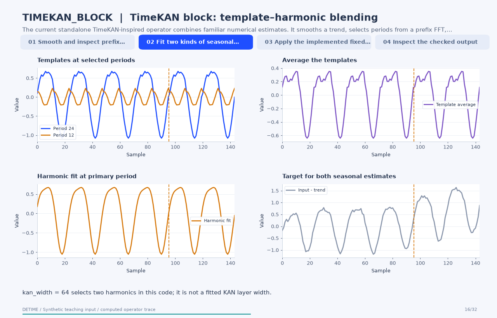

# TimeKAN block: template–harmonic blending

[Back to methods](../methods.md#animated-method-explanations)

**Method:** `TIMEKAN_BLOCK`. **Status:** experimental. **Implementation:** python.

<!-- detime:method-animation:start -->
## How it works

The current standalone TimeKAN-inspired operator combines familiar numerical estimates. It smooths a trend, selects periods from a prefix FFT, averages phase templates, and fits a harmonic projection at the supplied primary period. A fixed rule blends the two seasonal estimates. The animation shows that rule directly; it does not portray the complete frequency-decomposition KAN architecture from the cited paper.

[](../assets/generated/method-animations/timekan-block.gif)

Deterministic synthetic teaching signal; not a benchmark.

[Open GIF](../assets/generated/method-animations/timekan-block.gif) · [Static PNG](../assets/generated/method-animations/timekan-block.png) · [Source arrays (NPZ)](../assets/generated/method-animations/timekan-block.npz) · [Trace metadata](../assets/generated/method-animations/timekan-block.json)

### Follow the four steps

**1. Smooth and inspect prefix frequencies**

Estimate the trend from the selected prefix and use the detrended prefix FFT to obtain candidate periods.

**2. Fit two kinds of seasonal estimate**

Average phase templates at selected periods and separately fit a harmonic projection at primary_period.

**3. Apply the implemented fixed blend**

Combine the template average and harmonic projection using a weight determined by num_bands. No KAN is optimized in this operator.

**4. Inspect the checked output**

Return the smoothed trend, blended seasonal estimate and input-minus-components residual.

### Parameters that change the result

| Parameter | Effect on the computation |
|---|---|
| `num_bands` | Controls the selected template periods and the fixed blend weight 0.35 + 0.1 × min(num_bands, 4), clipped by the implementation. |
| `kan_width` | Maps to max(1, kan_width // 32) harmonics in this operator. |
| `primary_period` | Sets the harmonic projection's period; FFT-selected periods define the separate templates. |
| `fit_scope / train_fraction` | The animation explicitly fits on the first two thirds of the record. |

### What this animation computes

Intermediate arrays are computed with the implemented operator helpers. The final trend, season and residual are checked against public decompose(). The animation explains this standalone experimental block; its source architecture is cited for provenance.

### Interpretation

- No KAN coefficients or neural network are fitted by this standalone implementation.
- Template and harmonic components can overlap spectrally; the displayed blend is an explicit heuristic.
- Prefix fitting and suffix extension do not establish forecast accuracy or causal identification.
- The residual is defined from the observed series after forming both named components.

### Try the method

Use this configuration with DecompositionConfig and decompose. The animation generator supplies the teaching input and records intermediate arrays.

```json
{
  "method": "TIMEKAN_BLOCK",
  "params": {
    "primary_period": 24,
    "trend_window": 25,
    "num_bands": 2,
    "kan_width": 64,
    "fit_scope": "prefix",
    "train_fraction": 0.6666666666666666
  },
  "backend": "python"
}
```

See [the configuration reference](../config-reference.md#timekan_block) for the full interface and optional dependencies.

### Sources and reproduction

- [Implemented DeTime operator](https://github.com/systems-mechanobiology/DeTime/blob/main/src/detime/methods/neural_blocks/neural_block_portfolio.py)
- [Huang et al. (2025), TimeKAN: KAN-based Frequency Decomposition Learning Architecture for Long-term Time Series Forecasting](https://arxiv.org/abs/2502.06910)
- [DeTime implementation: `src/detime/methods/neural_blocks/neural_block_portfolio.py`](https://github.com/systems-mechanobiology/DeTime/blob/main/src/detime/methods/neural_blocks/neural_block_portfolio.py)

Regenerate this animation with `python scripts/generate_method_animations.py --methods TIMEKAN_BLOCK`.
The [reproduction guide](../maintenance/method-animations.md) explains the environment,
numerical checks, coverage manifest, and how to inspect the stored arrays.
<!-- detime:method-animation:end -->
