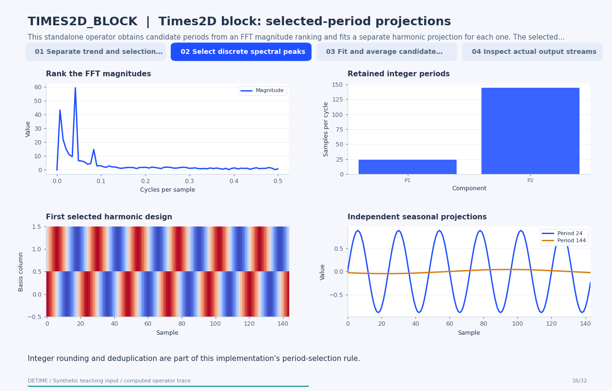

# Times2D block: selected-period projections

[← All 31 animations](index.md)

<!-- detime:method-animation:start -->
## How it works

**Method maturity:** `experimental`. **Implementation:** `python`.

This standalone operator obtains candidate periods from an FFT magnitude ranking and fits a separate harmonic projection for each one. The selected seasonal estimate is their equal-weight average. The frames expose the selection signal, rounded periods, candidate curves and averaging operation. The operator uses rounded FFT periods and harmonic projections. It does not implement a two-dimensional derivative-mapping forecasting backbone.

[](../assets/generated/method-animations/times2d-block.gif)

Deterministic synthetic teaching signal; not a benchmark.

[Open GIF](../assets/generated/method-animations/times2d-block.gif) · [Static PNG](../assets/generated/method-animations/times2d-block.png) · [Source arrays (NPZ)](../assets/generated/method-animations/times2d-block.npz) · [Trace metadata](../assets/generated/method-animations/times2d-block.json)

### Follow the four steps

**1. Separate trend and selection input**

Compute the moving-average trend. FreqMoE selects frequencies from the detrended signal; Times2D selects them from the original signal after mean removal.

**2. Select discrete spectral peaks**

Rank FFT magnitudes, convert bin positions into rounded integer periods, and retain distinct periods as implemented.

**3. Fit and average candidate seasons**

Fit a harmonic projection of the detrended signal for each selected period, then take the arithmetic mean of these projections.

**4. Inspect actual output streams**

The final trend, averaged projection and derived residual are checked against the public registered operator.

### Parameters that change the result

| Parameter | Effect on the computation |
|---|---|
| `trend_window` | Sets the centered moving-average trend. |
| `top_k_periods` | Controls how many distinct rounded FFT periods are retained. |
| `num_harmonics` | Sets the number of cosine/sine pairs in each candidate projection. |
| `fit_scope` | Explicitly full in this animation; prefix settings restrict the fitting interval. |

### What this animation computes

Intermediate arrays are computed with the implemented operator helpers. The final trend, season and residual are checked against public decompose(). The animation explains this standalone experimental block; its source architecture is cited for provenance.

### Interpretation

- The operator uses rounded FFT periods and harmonic projections. It does not implement a two-dimensional derivative-mapping forecasting backbone.
- A large FFT bin need not correspond to a stable physical oscillation. Trends, finite windows and rounding affect the selected periods.
- The independent candidate projections are averaged, rather than jointly fitted as one combined design.
- All coefficients use the selected fitting interval; no held-out forecast accuracy is shown.

### Try the method

Use this configuration with DecompositionConfig and decompose. The animation generator supplies the teaching input and records intermediate arrays.

```json
{
  "method": "TIMES2D_BLOCK",
  "params": {
    "primary_period": 24,
    "trend_window": 49,
    "fit_scope": "full",
    "top_k_periods": 2,
    "num_harmonics": 1
  },
  "backend": "python"
}
```

See [the configuration reference](../config-reference.md#times2d_block) for the full interface and optional dependencies.

### Sources and reproduction

- [Implemented DeTime operator](https://github.com/systems-mechanobiology/DeTime/blob/main/src/detime/methods/neural_blocks/neural_block_portfolio.py)
- [Nematirad, Pahwa, and Natarajan (2025), Times2D: Multi-Period Decomposition and Derivative Mapping for General Time Series Forecasting](https://arxiv.org/abs/2504.00118)
- [DeTime implementation: `src/detime/methods/neural_blocks/neural_block_portfolio.py`](https://github.com/systems-mechanobiology/DeTime/blob/main/src/detime/methods/neural_blocks/neural_block_portfolio.py)

Regenerate this animation with `python scripts/generate_method_animations.py --methods TIMES2D_BLOCK`.
The [reproduction guide](../maintenance/method-animations.md) explains the environment,
numerical checks, coverage manifest, and how to inspect the stored arrays.
<!-- detime:method-animation:end -->
