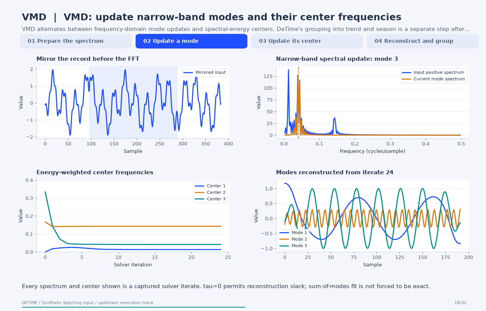
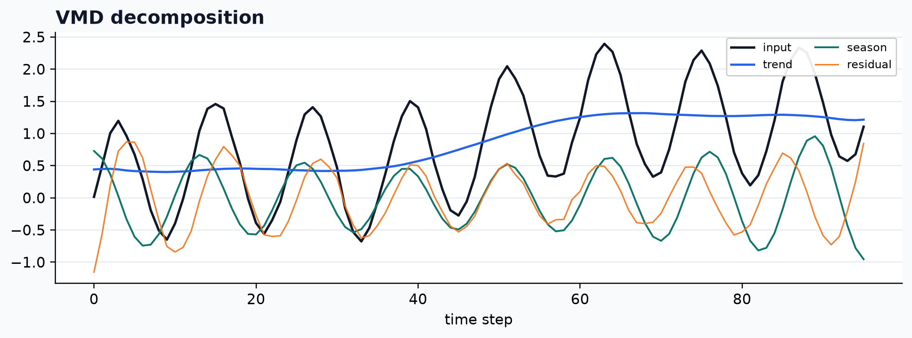

<a class="method-detail-back" href="../../notebook-gallery/">← Back to Gallery</a>

<div class="method-detail-header">
  <h1>Variational mode decomposition</h1>
  <p>Variational mode decomposition</p>
  <svg viewBox="0 0 400 100" xmlns="http://www.w3.org/2000/svg"><g fill="none" stroke-linecap="round"><path d="M0 50 C30 20 60 78 90 42 S150 16 180 52 S240 80 300 34 S360 14 400 50" stroke="#1F4FFF" stroke-width="2.6" stroke-opacity=".28"/><path d="M0 62 C80 58 160 48 240 38 S340 26 400 24" stroke="#00A6A6" stroke-width="2.2" stroke-opacity=".18"/><path d="M0 74 C20 66 40 82 60 72 S100 64 120 74 S160 82 180 72 S220 64 240 74 S300 82 400 68" stroke="#9AA8C7" stroke-width="1.8" stroke-opacity=".14"/></g></svg>
</div>

| Property | Value |
|---|---|
| **Method** | `VMD` |
| **Input mode** | `univariate` |
| **Trend shape** | `(96,)` |
| **Status** | ran |
| **Residual RMSE** | 0.03421948 |

<!-- detime:method-animation:start -->
## How it works

VMD alternates between frequency-domain mode updates and spectral-energy centers. DeTime's grouping into trend and season is a separate step after this optimization.

[](../assets/generated/method-animations/vmd.gif)

Deterministic synthetic teaching signal; not a benchmark.

[Open GIF](../assets/generated/method-animations/vmd.gif) · [Static PNG](../assets/generated/method-animations/vmd.png) · [Source arrays (NPZ)](../assets/generated/method-animations/vmd.npz) · [Trace metadata](../assets/generated/method-animations/vmd.json)

### Follow the four steps

**1. Prepare the spectrum**

Mirror the signal, compute its FFT, and retain the positive-frequency representation.

**2. Update a mode**

Fit the remaining spectrum with a bandwidth penalty around the current center frequency.

**3. Update its center**

Use the mode's positive-frequency energy to update its center, then repeat across modes.

**4. Reconstruct and group**

Complete the conjugate spectrum, invert the FFT, crop the mirrored margins, and group modes.

### Parameters that change the result

| Parameter | Effect on the computation |
|---|---|
| `K` | Number of modes; the demonstration uses 3. |
| `alpha` | Penalizes spectral spread around each center; the demonstration uses 1500. |
| `tau` | Dual-update step; zero permits noise slack and does not enforce an exact sum of modes. |
| `init / tol` | Initialization and convergence tolerance affect the computed solution. |

### What this animation computes

Captured vmdpy 0.2 loop arrays without changing solver updates; intermediate time-domain modes use its conjugate-completion and mirror-cropping convention.

### Interpretation

- The animation captures the optional vmdpy path; the native path has its own implementation and iteration control.
- Center frequencies shown here are raw solver frequencies in cycles/sample, not DeTime's converted metadata field.
- VMD modes need a grouping rule before being named trend or season; frequency ordering is not a physical-source guarantee.

### Try the method

Use this configuration with DecompositionConfig and decompose. The animation generator supplies the teaching input and records intermediate arrays.

```json
{
  "method": "VMD",
  "params": {
    "K": 3,
    "alpha": 1500.0,
    "tau": 0.0,
    "init": 1,
    "tol": 1e-07,
    "primary_period": 24
  },
  "backend": "python"
}
```

See [the configuration reference](../config-reference.md#vmd) for the full interface and optional dependencies.

### Sources and reproduction

- [Original VMD paper](https://doi.org/10.1109/TSP.2013.2288675)
- [vmdpy reference implementation](https://github.com/vrcarva/vmdpy)
- [Maintained sktime continuation](https://www.sktime.net/docs/api-reference/sktimetransformationsvmdvmdtransformer/)
- [DeTime implementation: `src/detime/methods/vmd.py`](https://github.com/systems-mechanobiology/DeTime/blob/main/src/detime/methods/vmd.py)
- [DeTime implementation: `native/src/vmd.cpp`](https://github.com/systems-mechanobiology/DeTime/blob/main/native/src/vmd.cpp)

Regenerate this animation with `python scripts/generate_method_animations.py --methods VMD`.
The [reproduction guide](../maintenance/method-animations.md) explains the environment,
numerical checks, coverage manifest, and how to inspect the stored arrays.
<!-- detime:method-animation:end -->

## Code

```python
case = CASES["VMD"]
run_gallery_case("VMD")
```

## Output

<div class="gallery-out">
<pre>
VMD: Variational mode decomposition
status: ran
...
</pre>
</div>

## Decomposition Plot


