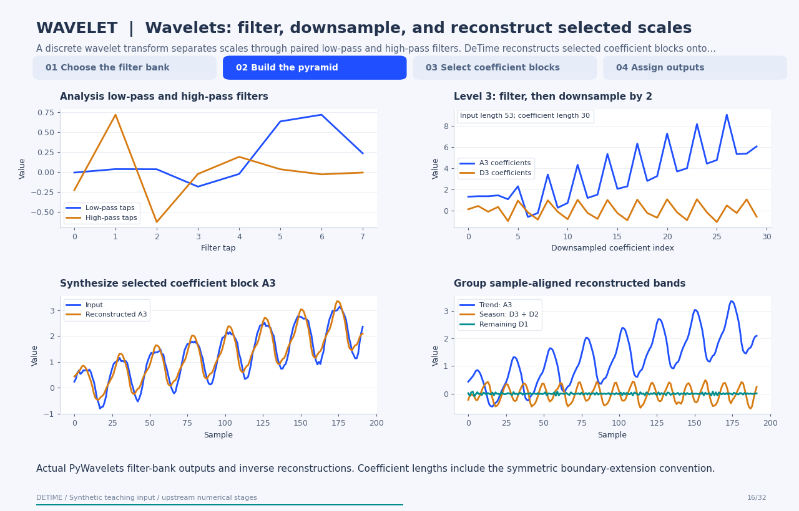
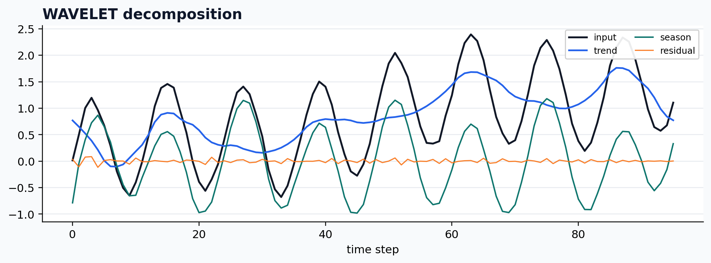

[← All 31 animations](index.md)

<div class="method-detail-header">
  <h1>Wavelet decomposition</h1>
  <p>Wavelet decomposition</p>
  <svg viewBox="0 0 400 100" xmlns="http://www.w3.org/2000/svg"><g fill="none" stroke-linecap="round"><path d="M0 50 C30 20 60 78 90 42 S150 16 180 52 S240 80 300 34 S360 14 400 50" stroke="#1F4FFF" stroke-width="2.6" stroke-opacity=".28"/><path d="M0 62 C80 58 160 48 240 38 S340 26 400 24" stroke="#00A6A6" stroke-width="2.2" stroke-opacity=".18"/><path d="M0 74 C20 66 40 82 60 72 S100 64 120 74 S160 82 180 72 S220 64 240 74 S300 82 400 68" stroke="#9AA8C7" stroke-width="1.8" stroke-opacity=".14"/></g></svg>
</div>

| Property | Value |
|---|---|
| **Method** | `WAVELET` |
| **Input mode** | `univariate` |
| **Trend shape** | `(96,)` |
| **Notebook execution** | ran |
| **Reconstruction RMSE** | 0.00000000 |

<!-- detime:notebook-metric:start -->
Notebook example metric: root mean square of `input - (trend + season + residual)` over all samples and channels. This checks additive bookkeeping; it is not a forecast error or a component-recovery score. The separate teaching input and intermediate arrays for the animation are linked below.
<!-- detime:notebook-metric:end -->

<!-- detime:method-animation:start -->
## How it works

**Method maturity:** `stable`. **Implementation:** `wrapper`.

A discrete wavelet transform separates scales through paired low-pass and high-pass filters. DeTime reconstructs selected coefficient blocks onto the original sample grid.

[](../assets/generated/method-animations/wavelet.gif)

Deterministic synthetic teaching signal; not a benchmark.

[Open GIF](../assets/generated/method-animations/wavelet.gif) · [Static PNG](../assets/generated/method-animations/wavelet.png) · [Source arrays (NPZ)](../assets/generated/method-animations/wavelet.npz) · [Trace metadata](../assets/generated/method-animations/wavelet.json)

### Follow the four steps

**1. Choose the filter bank**

The wavelet fixes the analysis and synthesis filters; this trace uses db4.

**2. Build the pyramid**

Low-pass and high-pass filtering are followed by decimation; repeat on the approximation.

**3. Select coefficient blocks**

Retain a block, zero the others, and apply the inverse transform to obtain a sample-aligned contribution.

**4. Assign outputs**

This example assigns A3 to trend and D3+D2 to season; the remainder is input minus those outputs.

### Parameters that change the result

| Parameter | Effect on the computation |
|---|---|
| `wavelet` | Controls filters and their support; db4 has eight analysis taps. |
| `level` | Controls pyramid depth; the example uses three levels. |
| `trend_levels / season_levels` | Indexes the wavedec list [A3,D3,D2,D1] here, not ascending physical scales. |
| `Boundary convention` | The current wrapper uses PyWavelets' default symmetric mode. |

### What this animation computes

Computed with PyWavelets 1.10.0; inverse band reconstructions call the current DeTime helper. Moving filter support is a labeled illustration; coefficient values are actual library outputs.

### Interpretation

- Wavelet detail coefficients are decimated and should not be mistaken for sample-aligned output curves.
- Assigning scales to trend or season is an application choice; the transform does not identify physical mechanisms.
- The animation uses a safe fixed depth; excessive levels make boundary effects dominate.

### Try the method

Use this configuration with DecompositionConfig and decompose. The animation generator supplies the teaching input and records intermediate arrays.

```json
{
  "method": "WAVELET",
  "params": {
    "wavelet": "db4",
    "level": 3,
    "trend_levels": [
      0
    ],
    "season_levels": [
      1,
      2
    ]
  }
}
```

See [the configuration reference](../config-reference.md#wavelet) for the full interface and optional dependencies.

### Sources and reproduction

- [PyWavelets discrete transform](https://pywavelets.readthedocs.io/en/stable/ref/dwt-discrete-wavelet-transform.html)
- [Inverse transform and partial reconstruction](https://pywavelets.readthedocs.io/en/stable/ref/idwt-inverse-discrete-wavelet-transform.html)
- [Signal-extension modes](https://pywavelets.readthedocs.io/en/stable/ref/signal-extension-modes.html)
- [DeTime implementation: `src/detime/methods/wavelet.py`](https://github.com/systems-mechanobiology/DeTime/blob/main/src/detime/methods/wavelet.py)

Regenerate this animation with `python scripts/generate_method_animations.py --methods WAVELET`.
The [reproduction guide](../maintenance/method-animations.md) explains the environment,
numerical checks, coverage manifest, and how to inspect the stored arrays.
<!-- detime:method-animation:end -->

## Code

```python
case = CASES["WAVELET"]
run_gallery_case("WAVELET")
```

## Output

<div class="gallery-out">
<pre>
WAVELET: Wavelet-based decomposition exposed through the common output contract.
status: ran
input mode: univariate
trend shape: (96,)
backend: python
reconstruction RMSE: 0.00000000
</pre>
</div>

## Decomposition Plot


