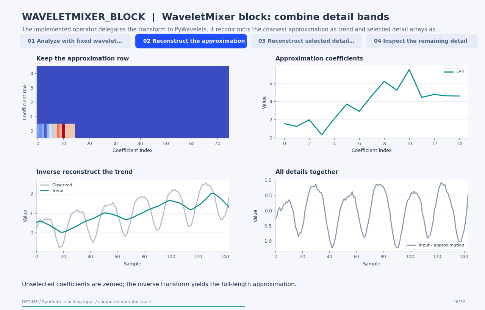

# WaveletMixer block: combine detail bands

[← All 31 animations](index.md)

<!-- detime:method-animation:start -->
## How it works

**Method maturity:** `experimental`. **Implementation:** `python`.

The implemented operator delegates the transform to PyWavelets. It reconstructs the coarsest approximation as trend and selected detail arrays as season, then derives the residual by subtraction. The animation exposes the analysis filter taps, coefficient arrays and inverse reconstructions. The WaveForM and WaveletMixer identifiers have different default wavelets and selected bands; neither operator runs the cited complete forecasting backbone.

[](../assets/generated/method-animations/waveletmixer-block.gif)

Deterministic synthetic teaching signal; not a benchmark.

[Open GIF](../assets/generated/method-animations/waveletmixer-block.gif) · [Static PNG](../assets/generated/method-animations/waveletmixer-block.png) · [Source arrays (NPZ)](../assets/generated/method-animations/waveletmixer-block.npz) · [Trace metadata](../assets/generated/method-animations/waveletmixer-block.json)

### Follow the four steps

**1. Analyze with fixed wavelet filters**

PyWavelets applies the selected analysis filters to produce approximation and detail coefficients at several resolutions.

**2. Reconstruct the approximation**

Keep only the coarsest approximation coefficients, zero the other coefficient arrays and apply inverse reconstruction to obtain the trend.

**3. Reconstruct selected detail bands**

Keep the explicitly selected coefficient-list positions and reconstruct their combined sample-aligned contribution as season.

**4. Inspect the remaining detail**

The residual is the observed input minus the approximation and selected details. All displayed components match the public operator.

### Parameters that change the result

| Parameter | Effect on the computation |
|---|---|
| `wavelet` | Selects the fixed analysis/synthesis wavelet family; db4 and sym4 are used by these two examples. |
| `level` | Requests decomposition depth, limited by the implementation using the input length and filter length. |
| `season_levels` | Contains coefficient-list positions: 1 denotes cD_L, 2 denotes cD_(L-1), and so on; position 0 is the trend approximation. |

### What this animation computes

Intermediate arrays are computed with the implemented operator helpers. The final trend, season and residual are checked against public decompose(). The animation explains this standalone experimental block; its source architecture is cited for provenance.

### Interpretation

- WaveForM's graph enhancement and WaveletMixer's trained mixing layers are outside these standalone operators.
- The source uses PyWavelets' default symmetric boundary extension; boundary values depend on that convention.
- A selected frequency-scale band is called season by the common result contract; periodic interpretation requires separate evidence.
- The coefficient heatmap pads unequal-length arrays with zeros for display only. Computation uses their original lengths.

### Try the method

Use this configuration with DecompositionConfig and decompose. The animation generator supplies the teaching input and records intermediate arrays.

```json
{
  "method": "WAVELETMIXER_BLOCK",
  "params": {
    "wavelet": "sym4",
    "level": 4,
    "season_levels": [
      1,
      2,
      3
    ]
  },
  "backend": "python"
}
```

See [the configuration reference](../config-reference.md#waveletmixer_block) for the full interface and optional dependencies.

### Sources and reproduction

- [Implemented DeTime operator](https://github.com/systems-mechanobiology/DeTime/blob/main/src/detime/methods/neural_blocks/neural_block_portfolio.py)
- [Zhang et al. (2025), WaveletMixer: A Multi-Resolution Wavelets Based MLP-Mixer for Multivariate Long-Term Time Series Forecasting](https://ojs.aaai.org/index.php/AAAI/article/view/34434)
- [DeTime implementation: `src/detime/methods/neural_blocks/neural_block_portfolio.py`](https://github.com/systems-mechanobiology/DeTime/blob/main/src/detime/methods/neural_blocks/neural_block_portfolio.py)

Regenerate this animation with `python scripts/generate_method_animations.py --methods WAVELETMIXER_BLOCK`.
The [reproduction guide](../maintenance/method-animations.md) explains the environment,
numerical checks, coverage manifest, and how to inspect the stored arrays.
<!-- detime:method-animation:end -->
