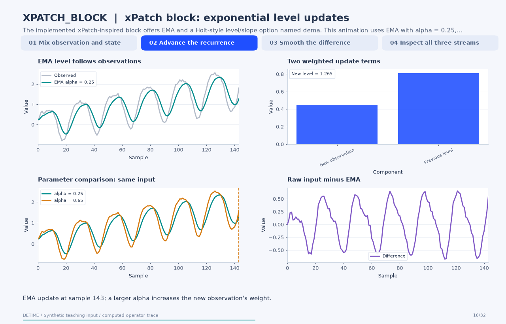

# xPatch block: exponential level updates

[Back to methods](../methods.md#animated-method-explanations)

**Method:** `XPATCH_BLOCK`. **Status:** experimental. **Implementation:** python.

<!-- detime:method-animation:start -->
## How it works

The implemented xPatch-inspired block offers EMA and a Holt-style level/slope option named dema. This animation uses EMA with alpha = 0.25, followed by the optional five-sample smoother of the nontrend stream. It shows the exact two-term update and the effect of a second alpha. The raw EMA is one-sided; the selected centered seasonal smoother changes that information boundary.

[](../assets/generated/method-animations/xpatch-block.gif)

Deterministic synthetic teaching signal; not a benchmark.

[Open GIF](../assets/generated/method-animations/xpatch-block.gif) · [Static PNG](../assets/generated/method-animations/xpatch-block.png) · [Source arrays (NPZ)](../assets/generated/method-animations/xpatch-block.npz) · [Trace metadata](../assets/generated/method-animations/xpatch-block.json)

### Follow the four steps

**1. Mix observation and state**

Initialize the level with the first sample, then update it as alpha times the observation plus one minus alpha times the previous level.

**2. Advance the recurrence**

Continue the EMA update through the record. A second, explicitly labelled alpha illustrates a parameter change.

**3. Smooth the difference**

This example smooths input minus trend with the requested five-sample centered mean; the remaining difference becomes residual.

**4. Inspect all three streams**

The final display matches the public xPatch-inspired operator at the stated configuration.

### Parameters that change the result

| Parameter | Effect on the computation |
|---|---|
| `alpha` | Weights the newest observation in the EMA level update; the other weight is 1 - alpha. |
| `ma_type` | Selects ema or the implemented Holt-style level/slope recurrence called dema. |
| `season_smooth` | Optionally smooths the nontrend stream with an odd centered mean; omission leaves a zero derived residual. |
| `beta` | Controls the slope update when ma_type='dema'; it does not affect the EMA path shown. |

### What this animation computes

Intermediate arrays are computed with the implemented operator helpers. The final trend, season and residual are checked against public decompose(). The animation explains this standalone experimental block; its source architecture is cited for provenance.

### Interpretation

- This operator does not run the complete xPatch forecasting architecture.
- The source's dema option is a level/slope recurrence; interpret it from the code rather than assuming every library uses the same DEMA definition.
- With season_smooth enabled, the seasonal stream uses centered smoothing even though EMA itself is one-sided.
- When alpha is omitted, trend_window can derive it. Explicit alpha takes precedence.

### Try the method

Use this configuration with DecompositionConfig and decompose. The animation generator supplies the teaching input and records intermediate arrays.

```json
{
  "method": "XPATCH_BLOCK",
  "params": {
    "ma_type": "ema",
    "alpha": 0.25,
    "season_smooth": 5
  },
  "backend": "python"
}
```

See [the configuration reference](../config-reference.md#xpatch_block) for the full interface and optional dependencies.

### Sources and reproduction

- [Implemented DeTime operator](https://github.com/systems-mechanobiology/DeTime/blob/main/src/detime/methods/neural_blocks/xpatch_block.py)
- [Stitsyuk and Choi (2024), xPatch: Dual-Stream Time Series Forecasting with Exponential Seasonal-Trend Decomposition](https://arxiv.org/abs/2412.17323)
- [DeTime implementation: `src/detime/methods/neural_blocks/xpatch_block.py`](https://github.com/systems-mechanobiology/DeTime/blob/main/src/detime/methods/neural_blocks/xpatch_block.py)

Regenerate this animation with `python scripts/generate_method_animations.py --methods XPATCH_BLOCK`.
The [reproduction guide](../maintenance/method-animations.md) explains the environment,
numerical checks, coverage manifest, and how to inspect the stored arrays.
<!-- detime:method-animation:end -->
